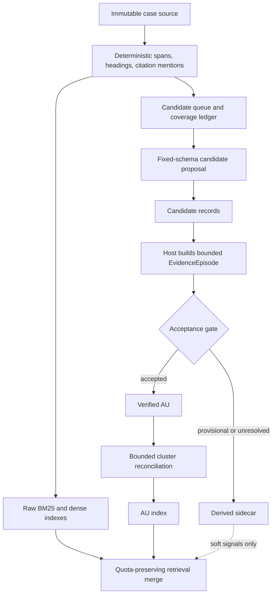

# Agent A — Vòng 4 phản biện chéo

## Phạm vi đối chiếu

Tôi đã đọc toàn bộ [báo cáo Agent B](/G:/Git/coliee-case-retrieval/knowledge_base/design/pipeline_redesign_lynx/agents/agent_b_initial.md) và đối chiếu với [báo cáo ban đầu của Agent A](/G:/Git/coliee-case-retrieval/knowledge_base/design/pipeline_redesign_lynx/agents/agent_a_initial.md). Hai bên thống nhất về phần lớn chẩn đoán nền: raw source phải bất biến và searchable độc lập; `complete/schema-valid` không phải quality gate; V15 thất bại vì candidate discovery bị gộp với materialization và schema toàn-case; Lynx hỗ trợ contract/provenance nhiều hơn là chứng minh full KG có hiệu quả.

Các phản biện dưới đây chỉ giữ những bất đồng có thể thay đổi kiến trúc hoặc phép thử. KOS, locked opportunity và agent review vẫn không được coi là gold.

---

# I. Tám phản biện quan trọng

## 1. Candidate priority và fixed cap chưa đủ bảo vệ đoạn không citation, source dài ít AU và schema-valid omission

**Nhận định bị phản biện →** Agent B đề xuất `Cheap candidate queue` dùng citation presence, court-language cues, heading path, lexical rarity và retrieval salience; source dài ít AU được xử lý bằng fixed item cap và dừng theo marginal gain. Raw source index được xem là hàng rào đủ để phần không enrich vẫn có thể được tìm.

**Bằng chứng/phản ví dụ →** V13 `099980` đã có raw source và batch assessment nhận ra các cơ hội, nhưng run vẫn hoàn tất rỗng sau khi chỉ đọc khoảng 43% nguồn. V14/V15 cũng cho thấy schema-valid hoặc triage-complete không ngăn semantic omission. Một đoạn không citation, dùng ngôn ngữ bình thường nhưng chứa application reasoning có thể nhận điểm thấp ở tất cả tín hiệu của candidate queue. Với source dài nhưng chỉ có một hoặc hai AU hữu ích, marginal gain có thể về thấp trước khi tới đúng vùng đó. Raw fallback bảo vệ khả năng tìm case ở retrieval time, nhưng không chứng minh AU builder đã hoàn tất đúng và không giúp đánh giá omission của structured view.

**Hậu quả →** Pipeline có thể báo enrichment thành công, chi phí thấp và coverage kỹ thuật cao trong khi structured index bỏ đúng các đoạn khó. Combined retrieval vẫn có thể đạt recall nhờ raw lane, che đi việc AU lane không tạo thêm giá trị. Nếu downstream ưu tiên AU hit, lỗi này tiếp tục gây lệch candidate pool.

**Phương án thay thế →** Candidate queue chỉ quyết định thứ tự, không quyết định coverage. Thêm `CandidateCoverageLedger` theo paragraph/section với các trạng thái `not_scanned`, `screened_negative(reason, producer)`, `candidate`, `uncertain`, `error`. Mỗi case phải có một coverage floor được định nghĩa trước: quét deterministic toàn nguồn; model proposal theo batch cố định chỉ trên phần cần thiết; lấy mẫu sentinel từ các negative strata gồm đoạn không citation, đoạn giữa section, đoạn sau heading và đoạn có discourse connective. Với source dài, dừng theo budget nhưng phải ghi `partial_coverage`, không gọi semantic-complete. Raw lane vẫn độc lập.

**Phép thử phân xử →** Tạo holdout paragraph-level có cả positive không citation và source dài ít AU. So sánh Agent B queue-cap với queue + stratified sentinel sampling ở cùng token budget. Đo AU opportunity recall, false-empty rate, số positive chỉ raw lane tìm thấy và tỷ lệ run schema-valid nhưng bỏ sót. Nếu queue-cap không kém có ý nghĩa và rẻ hơn, bỏ coverage floor mở rộng.

## 2. Candidate “low risk” không nên được tự động chấp nhận thành AU

**Nhận định bị phản biện →** Sơ đồ T1 của Agent B cho nhánh `Risk or uncertainty? = Low` đi thẳng tới `Accept minimal AU candidate`; chỉ candidate high-risk mới qua targeted context expansion và verifier.

**Bằng chứng/phản ví dụ →** Lỗi party-versus-court có thể bề ngoài rất “low risk”: một paragraph có citation, động từ pháp lý và proposition hoàn chỉnh nhưng thực ra nằm trong phần submissions. V15 P0204 được giữ nhưng gán sai AU thay vì brief disposition; V13 `013948` có item gần issue/brief và attribution đáng ngờ dù run hoàn tất. Không có tín hiệu cheap nào hiện đã được đánh giá đủ để chứng minh absence of risk. LKG provenance cho biết ai tạo annotation, không làm annotation đúng về speaker hoặc legal function.

**Hậu quả →** Nhánh low-risk có thể đưa party argument, quoted authority hoặc bare disposition vào canonical AU mà không có evidence contract. Sai sót sau đó được cache và truyền sang AU index, nơi nó có vẻ đáng tin hơn raw span vì đã mang nhãn cấu trúc.

**Phương án thay thế →** Tách `candidate` khỏi `accepted AU` tuyệt đối. Low-risk candidate có thể bỏ qua model context expansion, nhưng vẫn phải qua acceptance gate tối thiểu: exact span/hash, non-heading/non-question checks, speaker evidence, legal-function evidence và overlap/duplicate checks. Nếu các trường ngữ nghĩa chưa được xác nhận, lưu `provisional` hoặc `unresolved`, không `accepted`. Một rule-based acceptance chỉ được phép cho invariant cấu trúc; không được tự xác nhận court voice hoặc legal proposition.

**Phép thử phân xử →** Lập tập contrastive gồm cùng câu đặt trong court reasoning, party submission, quoted authority và headnote/heading. Chạy low-risk path mà không verifier và path có acceptance gate. Đo attribution error, AU-kind error và token. Chỉ cho phép auto-accept loại cụ thể nếu upper confidence bound của error nằm dưới ngưỡng khóa trước.

## 3. Context expansion theo trigger cục bộ chưa đủ cho điều kiện đoạn trước và court response ở xa

**Nhận định bị phản biện →** Agent B mở rộng context khi câu bắt đầu bằng dependent connective, qualifier có thể nằm ở đoạn trước, citation/treatment cần current-court response hoặc model yêu cầu `needs_context`; `open_span` lấy before/after và tìm tiếp theo citation/authority trong cùng case.

**Bằng chứng/phản ví dụ →** Điều kiện có thể nằm ở paragraph trước mà paragraph hiện tại không có connective rõ ràng. Court response có thể xuất hiện trước authority quotation, ở cuối một chuỗi phân tích dài, hoặc không lặp citation string. `045155` đã tìm được evidence “authority applies” nhưng thiếu receiving-court response dù gần như đã đọc hết source. Chỉ tìm “tiếp theo citation/authority” dễ lấy lại proposition của cited case thay vì lời đánh giá của tòa hiện tại.

**Hậu quả →** AU bị mất qualification; treatment phản ánh quoted authority hoặc lời party thay vì court response. Việc trả `unknown` bảo vệ correctness nhưng có thể làm phần lớn treatment sidecar vô dụng và khiến verifier mở context lặp nhiều lần.

**Phương án thay thế →** Host dựng một `EvidenceEpisode` tạm cho mỗi candidate: proposition span; predecessor/successor paragraphs; containing section; tất cả mention cùng authority; các đoạn có court-response cues ở cả hai hướng; khoảng cách và lý do mở. Verifier nhận episode đã deduplicate với hard token cap. `qualification_refs[]` và `court_response_refs[]` là role riêng; thiếu role bắt buộc thì AU vẫn có thể tồn tại nhưng qualification/treatment phải `unknown`. Episode là runtime/derived data, không phải KG edge.

**Phép thử phân xử →** Tập challenge phải có bốn khoảng cách: cùng câu, paragraph trước, 2–5 paragraph, section khác; court response cả trước và sau mention. So sánh adjacent-only, forward-authority search và EvidenceEpisode hai chiều theo witness recall, attribution/treatment accuracy, unique source tokens và repeated tokens.

## 4. Tiêu chí giữ NER/concept sidecar của Agent B chưa phân xử được concept sai

**Nhận định bị phản biện →** Agent B giữ optional NER/concept sidecar nếu combined Recall@100 tăng ít nhất 2 điểm tuyệt đối hoặc query-time tokens giảm 30% trong khi Recall@100 giảm không quá 1 điểm.

**Bằng chứng/phản ví dụ →** Các ngưỡng 2 điểm/30% là proposal chưa có power analysis. NER Lynx được đánh giá trên German decisions với sentence-wise cross-validation; terminology work chủ yếu là Spanish labour law. Một concept linker có thể cải thiện recall trung bình bằng cách thêm candidate phổ biến nhưng làm hỏng hard-tail query do sense/jurisdiction sai. Recall@100 aggregate cũng không cho biết case nào chỉ xuất hiện nhờ concept channel, case nào bị đẩy ra, hay concept có khiến agent đọc sai nguồn không.

**Hậu quả →** Sidecar có thể được giữ vì metric trung bình vượt ngưỡng tùy ý dù không tạo giá trị độc quyền, tăng build/invalidation cost và làm query drift. Khi concept sai được trình bày như metadata, model có thể tin annotation hơn source.

**Phương án thay thế →** Concept/NER chỉ là channel có provenance và confidence; không hard-filter, không thay raw query. Tiêu chí giữ phải gồm paired confidence interval, `exclusive relevant cases gained/lost`, calibration/error theo entity/concept type, token và maintenance cost. Mỗi result phải cho biết contribution của raw, AU và concept channel. Nếu concept xung đột exact text, source thắng và disagreement được ghi.

**Phép thử phân xử →** Dùng holdout có concept polysemy, synonym, wrong-jurisdiction terms và citation-like entity. So sánh raw-only với raw+concept ở cùng candidate budget. Đo Recall@50/100/200, cases gained/lost riêng, query drift rate và downstream source-selection error. Loại sidecar nếu không tạo relevant cases độc quyền ổn định qua bootstrap interval.

## 5. `noticed_case_prediction` cần hợp đồng chặt hơn cho masked citation

**Nhận định bị phản biện →** Agent B tách `citation_mention`, `authority_candidate` và `noticed_case_prediction`, trong đó noticed prediction được tạo ở retrieval time; query-time chỉ nhận masked query và không truy cập unmasked/gold.

**Bằng chứng/phản ví dụ →** Phân tách này đúng về khái niệm nhưng chưa nói rõ provenance boundary của feature và cache. Nếu candidate case hoặc authority link đã được xây từ train-gold pair, unmasked query, known noticed case hay artifact KOS có gold candidates, retrieval-time predictor vẫn có thể “không trực tiếp đọc gold” nhưng nhận leakage qua persistent data. Masked citation còn làm citation-channel không có tín hiệu ở đúng chỗ cần tìm; model có thể suy diễn citation cụ thể từ surrounding facts thay vì retrieval corpus.

**Hậu quả →** Recall tăng giả do leakage, hoặc noticed prediction trở thành hidden reranker vượt phạm vi thiết kế hiện tại. Kết quả khó tái lập và không còn là gold-blind candidate retrieval.

**Phương án thay thế →** `noticed_case_prediction` chỉ tồn tại trong query `Workspace`, không persistent trong Case/AU sidecar. Mỗi feature phải có `origin` và audit flag xác nhận không dùng unmasked/gold. Corpus preprocessing không nhận query-pair labels. Persistent authority linking chỉ được xây từ chính candidate judgment/source công khai; không ghi quan hệ “noticed by query”. Evaluation runner chặn truy cập unmasked fields và KOS gold-derived matches.

**Phép thử phân xử →** Chạy leakage audit bằng cách xây lại index từ corpus-only snapshot, xóa toàn bộ query-derived cache và so sánh checksum/result với run tiêu chuẩn. Thực hiện negative control hoán vị gold noticed labels; nếu retrieval thay đổi trước evaluation, có leakage. Báo Recall của masked-only run riêng.

## 6. Treatment state chưa được tách đủ khỏi relevance đối với case bị distinguish hoặc reject

**Nhận định bị phản biện →** Agent B lưu `treatment state` trong AU và trả annotation qua retrieval interface, nhưng chưa khóa invariant rằng adverse treatment không được giảm khả năng case xuất hiện. Tám tình huống của Agent B cũng chưa xét riêng case bị distinguished/rejected nhưng vẫn là target retrieval.

**Bằng chứng/phản ví dụ →** COLIEE Task 1 cần tìm noticed cases, không chỉ authority được áp dụng tích cực. Một case được court phân biệt, từ chối áp dụng hoặc phê bình vẫn có thể là noticed case. V13 `045155` cho thấy treatment evidence còn khó xác nhận; dùng trường này trong candidate score trước khi có two-witness evidence sẽ dễ loại đúng target.

**Hậu quả →** Pipeline có thể tăng precision biểu kiến bằng cách hạ điểm adverse authority nhưng làm giảm recall/F1 thực. Sai treatment còn có tác động kép: vừa gán sai nghĩa vừa đổi ranking.

**Phương án thay thế →** Treatment là descriptive evidence trong AU/Workspace, không phải relevance label. `search_source` và quota raw không dùng treatment để loại hoặc hạ hard score. Nếu treatment dùng làm feature, phải có channel riêng, ablation riêng và monotonic coverage rule: candidate adverse không được bị loại khỏi pre-rerank pool chỉ vì treatment. `supports`, `distinguishes`, `rejects`, `mentions` đều có thể retrieval-relevant.

**Phép thử phân xử →** Tạo slice holdout theo positive/neutral/adverse treatment, gồm distinguish và reject. So sánh ranking có/không treatment feature ở cùng K. Đo Recall@K từng slice và số gold case bị treatment đẩy khỏi pool; bất kỳ suy giảm adverse-slice nào không được bù bằng raw quota là lý do bỏ feature.

## 7. B1/T1 vẫn ngầm giả định eager AU build toàn corpus; break-even cần so với lazy enrichment

**Nhận định bị phản biện →** B1 chạy candidate proposal và verification theo mọi fixed-size batch; T1 tạo cheap candidate queue rồi selective verification. Break-even dùng một chi phí build enrichment `E` và quy tắc giảm ít nhất 30% token so với B1.

**Bằng chứng/phản ví dụ →** Dù chỉ hai call type, model proposal trên mọi batch vẫn là corpus-wide inference. V15 chứng minh batch nhỏ không đồng nghĩa tổng request nhỏ: 53 triage request cho một case. Nếu phần lớn case hiếm khi được mở, AU preprocessing không có cơ hội hoàn vốn. Công thức `E/(Q0-Q1)` chưa tính chi phí invalidation khi source/model/prompt đổi, failure/retry, và distribution reuse theo case.

**Hậu quả →** T1 có thể thắng B1 30% nhưng vẫn thua B0 + on-demand enrichment về tổng lifecycle cost. Một threshold tương đối với baseline đắt không chứng minh kiến trúc đáng triển khai.

**Phương án thay thế →** Thêm arm `L1 = B0 + lazy candidate/AU materialization`. Chỉ enrich khi case đạt trigger đã khóa: xuất hiện trong top-K của nhiều query, được agent mở, hoặc nằm trong calibration/build sample. Cache theo case/source hash. Break-even tính theo distribution reuse: build, failed attempts, invalidation/rebuild và query cost. B1 eager chỉ là stress/control arm, không mặc định là deployment baseline.

**Phép thử phân xử →** Replay một workload query theo thứ tự thời gian trên B0, B1 eager, T1 eager-selective và L1 lazy. Đo cumulative tokens/latency/cost, Recall@K và số case enriched theo thời gian. Xác định crossover theo số query và source-update rate; chọn eager chỉ nếu vượt lazy trong khoảng reuse thực tế dự kiến.

## 8. Bỏ global finalizer là đúng, nhưng cần reconciliation bounded giữa các batch

**Nhận định bị phản biện →** Agent B bác bỏ global finalizer/classification schema và ghi rằng deterministic dedup có thể không đủ, nhưng thiết kế chưa chốt bước xử lý semantic duplicate, conflicting kind hoặc qualification bị chia giữa các batch.

**Bằng chứng/phản ví dụ →** V13 `013948` có hai AU gần duplicate và một item gần brief/issues. Exact overlap hoặc text similarity không chắc nhận ra hai proposition diễn đạt khác nhau; ngược lại, hai spans gần nhau có thể là rule và exception cần giữ riêng. Fixed batches làm cùng một reasoning episode dễ bị tách qua ranh giới batch. Không có reconciliation, lỗi local hợp schema tích lũy thành KB nhiễu.

**Hậu quả →** AU index bị duplicate, conflict hoặc mất điều kiện. Retrieval có thể dành nhiều slot cho cùng case/proposition; token query-time tăng. Nếu thêm lại global finalizer toàn-case thì lặp đúng lỗi schema explosion của V15.

**Phương án thay thế →** Dùng `bounded reconciliation`: host cluster candidate/AU theo overlap, parent section, embedding similarity và shared citation; exact/contained duplicate xử lý deterministic. Chỉ cluster ambiguous mới qua một fixed-schema reconciliation call với tối đa `c` items và exact evidence refs. Không gửi toàn case, không tạo field động theo toàn bộ item. Kết quả là `keep`, `merge`, `link_as_qualification`, `keep_distinct` hoặc `unresolved`.

**Phép thử phân xử →** Tạo bộ pair/cluster gồm exact duplicate, paraphrase duplicate, rule–exception, rule–application, brief–AU và spans ở hai batch liền nhau. So sánh no reconciliation, deterministic-only và bounded reconciliation theo duplicate precision/recall, condition retention, token và request failure.

---

# II. Steelman phiên bản mạnh nhất của Agent B

Phiên bản mạnh nhất của Agent B không phải “thêm sidecar”, mà là một kiến trúc kiểm soát failure surface:

1. **Raw spine là sản phẩm chính.** Mọi case luôn có raw source, exact offsets, hash và raw retrieval độc lập. Enrichment không quyết định case có tồn tại trong retrieval hay không.
2. **Candidate discovery tách khỏi AU materialization.** V15 thất bại vì 205 paragraph gần như lập tức biến thành 219 item. Candidate nhẹ cho phép trì hoãn schema ngữ nghĩa và chỉ kiểm chứng phần có ích.
3. **Schema cố định theo batch.** Không tạo một field bắt buộc cho từng source/item của cả case; preflight theo bytes/tokens và fail-fast với request quá lớn.
4. **Selective verifier theo risk.** Attribution, qualifier, treatment, duplicate và evidence xa mới tiêu tốn context mở rộng. Verifier nhận evidence cụ thể thay vì toàn case.
5. **Failure contract vận hành rõ.** Phân biệt logical request với transport attempts; `5xx/timeout`, HTTP 400, schema invalid và semantic uncertainty có cách xử lý khác nhau. Mỗi output immutable theo fingerprint, resume idempotent và lỗi batch cục bộ không xóa kết quả trước.
6. **Data contract đúng hướng.** `Case`, `SpanRef`, `AU`, rebuildable `Annotation` và `Attempt`; citation mention, authority candidate và noticed-case prediction là ba lớp khác nhau.
7. **Không sao chép stack Lynx.** Chỉ lấy stable contract, provenance và replaceable worker; không dựng RDF/Camunda/microservice trước khi chứng minh giá trị.
8. **Thiết kế có counterfactual.** Nếu raw-only tương đương combined thì bỏ corpus-wide AU; nếu fixed schema vẫn over-select thì đổi task formulation thay vì thêm phase.

Ở dạng này, Agent B đưa ra baseline thực thi mạnh hơn bản Agent A ban đầu: nó buộc candidate lifecycle và failure accounting trở thành phần của kiến trúc, thay vì chỉ là chi tiết triển khai.

---

# III. Điểm Agent A thay đổi quan điểm

## 1. Chấp nhận lớp `Candidate` riêng

Bản ban đầu của tôi đi từ bounded source bundle tới model-selected span rồi verifier/AU. Sau phản biện, tôi cho rằng cần persistent hoặc rebuildable `CandidateRecord` riêng. Candidate không phải AU và không mang uy tín pháp lý mặc định.

## 2. Chấp nhận fixed schema theo batch là invariant kiến trúc

Tôi trước đó nhấn mạnh bounded context nhưng chưa khóa rằng schema cũng phải bounded và không phụ thuộc tổng số item. Nay tôi coi `fixed schema + hard preflight cap` là yêu cầu bắt buộc.

## 3. Bỏ mọi global finalizer toàn-case

Tôi giữ nhu cầu reconcile semantic duplicate/qualification, nhưng chuyển nó thành cluster-level reconciliation có cap. Không có request nào chứa mọi AU hoặc mọi paragraph của case.

## 4. Thêm `Attempt` và tách transport retry khỏi logical retry

Bảng chi phí phải ghi logical request, transport attempt, provider usage, latency và error class. HTTP 503 warmup không được báo như semantic retry; HTTP 400 cùng payload không được retry mù.

## 5. Chuyển lazy enrichment từ lựa chọn phụ thành deployment mặc định cần so sánh

Bản ban đầu đã đề xuất lazy AU nhưng chưa đặt nó thành arm riêng đối đầu eager selective build. Sau Agent B, tôi chốt `B0 + lazy enrichment` là deployment candidate chính; eager B1/T1 chỉ được chọn khi workload replay chứng minh hòa vốn.

## 6. Giữ bất đồng về low-risk auto-accept

Tôi không chấp nhận việc candidate low-risk đi thẳng thành accepted AU. Có thể bỏ model verifier nếu invariant cấu trúc đủ rõ, nhưng nhãn speaker, proposition, qualification và treatment chưa được xác nhận phải ở trạng thái provisional/unknown.

---

# IV. Thiết kế Agent A đã sửa

## 1. Kiến trúc tổng thể



## 2. Corpus-time bắt buộc, không dùng model

Host thực hiện:

- lưu raw source bất biến;
- tính `source_hash` và `source_version`;
- tạo paragraph/sentence `SpanRef` với exact offsets;
- tạo heading path và structural flags;
- trích `citation_mention` deterministic với producer/version;
- xây full-case, paragraph/chunk BM25 và dense index nếu embedding baseline đã được khóa;
- tạo index metadata và invalidation dependency.

Kết quả corpus-time này đủ cho B0 và bảo đảm case không có AU/annotation vẫn searchable.

## 3. Candidate lifecycle

### `CandidateRecord`

```text
candidate_id
case_id
source_hash
span_refs[]
origin                 # deterministic | model_proposal | query_salience
priority_features[]
coverage_batch_id
status                 # proposed | screened_negative | uncertain |
                       # accepted | rejected | error
producer_fingerprint
attempt_ids[]
```

Candidate proposal dùng schema cố định, ví dụ:

```text
selected_span_ids: maxItems=m
needs_context_span_ids: maxItems=m
uncertain_span_ids: maxItems=m
```

Không có một field bắt buộc cho mỗi paragraph. Một batch chỉ chứa một mức hạt; host xử lý parent-child overlap trước request tiếp theo.

## 4. Coverage và omission

`CandidateCoverageLedger` ghi theo paragraph/section:

```text
not_scanned
screened_negative(reason, producer)
candidate(candidate_id)
uncertain
error
not_processed_budget
```

Hai khái niệm completion tách biệt:

- `execution_complete`: mọi batch được xử lý hoặc có lỗi/stop reason rõ;
- `semantic_coverage`: metric đánh giá trên holdout, không suy ra từ ledger.

Mỗi run lấy sentinel sample từ screened negatives. Nếu positive omission vượt threshold, không được tăng quy mô hoặc tuyên bố tiết kiệm.

## 5. EvidenceEpisode và context expansion

Host dựng bundle có cap từ:

- candidate span;
- paragraph trước/sau;
- containing heading/section;
- predecessor có condition/exception cues;
- các mention cùng authority;
- court-response candidate ở cả hai hướng;
- provenance cho lý do mỗi span được mở.

Host deduplicate exact text trước khi gửi model. Model không được tự yêu cầu toàn case; mọi expansion đi qua tool với budget còn lại.

## 6. Acceptance gate

Một AU chỉ `accepted` khi có:

- exact source refs và source hash hợp lệ;
- legal function đã xác nhận;
- speaker state có evidence hoặc được ghi `unknown` không gây hiểu nhầm;
- qualification refs nếu proposition phụ thuộc điều kiện;
- parent-child/heading/question checks;
- producer và verifier fingerprints.

Treatment là trường tùy chọn. Chỉ gán treatment cụ thể khi có cả `authority_witness_refs[]` và `current_court_response_refs[]`; nếu không thì `unknown`.

Low-risk candidate không tự thành accepted AU. Nó có thể thành provisional sidecar với chi phí thấp và chỉ được dùng như soft signal.

## 7. Bounded reconciliation

Host cluster theo:

- exact/contained overlap;
- cùng section/episode;
- shared authority;
- semantic similarity;
- conflicting function/speaker labels.

Exact duplicate xử lý deterministic. Cluster ambiguous tối đa `c` item được gửi qua fixed-schema reconciliation. Không có global finalizer và không gửi toàn case.

## 8. Persistent, derived và runtime data

### Persistent canonical

- `Case`;
- immutable source/version;
- `SpanRef` manifest;
- accepted `AU` với exact evidence/provenance.

### Derived, rebuildable

- `CandidateRecord`;
- citation/entity/concept/speaker sidecars;
- coverage ledger;
- raw/AU indexes;
- duplicate clusters;
- materialized excerpts.

### Operational

- `Attempt`: logical request ID, transport attempts, usage, latency, error class, input/output fingerprint;
- checkpoint/apply state;
- invalidation dependencies.

### Query runtime

- masked query;
- NN/authority need nếu agent tạo;
- candidate cases và channel contributions;
- opened evidence;
- uncertainty/open questions;
- noticed-case predictions;
- budget và stop reason.

Query-derived noticed prediction không được ghi vào persistent Case/AU.

## 9. Retrieval interface đã sửa

```text
search_source(query, k, filters?) -> RawHit[]
search_au(query, k, filters?) -> AUHit[]
search_combined(query, k, raw_quota, au_quota, fusion) -> CaseHit[]
get_case(case_id, source_version?) -> CaseMetadata
open_span(case_id, source_hash, start, end) -> ExactSource
expand_context(span_ref, expansion_policy, budget) -> EvidenceEpisode
get_annotations(span_ref, types?, statuses?) -> DerivedAnnotation[]
explain_hit(case_id) -> ChannelContribution[]
```

Mỗi hit có `case_id`, source version/hash, exact evidence, channel, score và producer/index fingerprint. Raw quota không được annotation làm giảm. Treatment và concept không phải hard filter.

## 10. Failure, cache và resume

- Stage là hàm `input fingerprint → immutable output`.
- Fingerprint gồm source, segmentation, prompt/schema, model/extractor và index config versions.
- `429/5xx/timeout`: bounded transport retry/backoff.
- `400/schema-too-large`: fail-fast, chia batch hoặc sửa contract; không retry cùng payload.
- Invalid JSON/schema/host contract: giữ raw response, batch failed, không apply.
- Semantic uncertainty: `provisional/unresolved`, không phải execution failure.
- Apply idempotent theo operation ID; đã apply không apply lại.
- Source đổi: invalidate span-dependent data.
- Model/prompt đổi: invalidate outputs của producer đó, giữ source và deterministic spans.
- Một batch lỗi không xóa output hợp lệ khác.

## 11. Các tình huống bắt buộc trong thiết kế đã sửa

| Tình huống | Hàng rào |
|---|---|
| Đoạn không citation nhưng hữu ích | Raw index toàn corpus; candidate queue không hard-filter citation; negative sentinel sampling |
| Party bị hiểu thành court | Không auto-accept; speaker evidence trong acceptance gate; thiếu thì provisional/unknown |
| Điều kiện ở đoạn trước | EvidenceEpisode hai chiều; `qualification_refs[]` riêng |
| Court response ở xa | Authority episode gồm all mentions và bidirectional court-response search; treatment cần two-witness contract |
| Concept sai | Soft channel, source thắng khi xung đột; báo cases gained/lost theo channel |
| Source dài ít AU | Không ép quota AU; ledger ghi partial coverage; raw source vẫn searchable |
| Masked citation | Corpus-only preprocessing; prediction query-time trong Workspace; leakage audit và cache separation |
| Schema-valid omission | Execution và semantic coverage tách riêng; locked holdout + negative sampling |
| Case distinguish/reject | Treatment không phải relevance label; adverse cases giữ trong raw/pre-rerank pool |

## 12. Arms và phép thử quyết định

| Arm | Nội dung |
|---|---|
| B0 | Raw source BM25+dense |
| B1 | B0 + eager fixed-batch candidate proposal + one verification gate |
| L1 | B0 + lazy candidate/AU materialization và cache |
| T1a | L1 + EvidenceEpisode targeted context |
| T1b | T1a + deterministic citation/authority sidecar |
| T1c | T1b + optional NER/concept sidecar |
| T1d | T1c + optional treatment sidecar với two-witness contract |

Đánh giá:

- **Structural:** offsets/hash, source immutability, invalidation, idempotent resume, failure isolation.
- **Semantic:** omission, qualifier loss, attribution, treatment, duplicate, heading/question error.
- **Efficiency:** logical requests, transport attempts, successful/failed token usage, repeated source, latency, build/rebuild/query lifecycle cost.
- **Retrieval:** Recall@50/100/200 cho raw/AU/combined, channel-exclusive gold cases và adverse-treatment slice.
- **Leakage:** corpus-only rebuild, cache purge và permuted-gold negative control.

Năm case hiện tại chỉ dùng calibration/error analysis. Holdout phải khóa trước khi điều chỉnh. Mục tiêu giảm 30% token chỉ được chấp nhận khi Recall@K và semantic metrics không kém trong tiêu chí đã đăng ký trước.

## 13. Quyết định sửa đổi cuối của Agent A

| Thành phần | Quyết định sau phản biện |
|---|---|
| Immutable source + raw retrieval | Chấp nhận bắt buộc |
| Candidate tách AU | Chấp nhận bắt buộc; thay đổi so với bản đầu |
| Fixed-schema batch + preflight cap | Chấp nhận bắt buộc; thay đổi so với bản đầu |
| Attempt/transport accounting | Chấp nhận bắt buộc; bổ sung từ Agent B |
| Lazy enrichment | Deployment candidate mặc định; phải so với eager replay |
| Selective EvidenceEpisode verifier | Cần thực nghiệm nhưng là hướng khuyến nghị |
| Low-risk auto-accept AU | Bác bỏ nếu chưa có semantic acceptance evidence |
| Bounded reconciliation | Chấp nhận; thay global finalizer |
| Citation deterministic sidecar | Cần thực nghiệm, soft feature |
| NER/concept sidecar | Chưa chấp nhận; chỉ ablation |
| Treatment sidecar | Chưa chấp nhận; không dùng làm relevance filter |
| Full RDF/LKG và distributed Lynx stack | Bác bỏ cho pilot đầu |

Thiết kế sửa đổi giữ lập trường correctness-first của Agent A nhưng tiếp nhận phần mạnh nhất của Agent B về candidate lifecycle, schema bounded và failure accounting. Bất đồng còn lại được chuyển thành ablation: auto-accept so với acceptance gate, eager so với lazy enrichment, adjacent context so với EvidenceEpisode, và deterministic-only so với bounded reconciliation.
