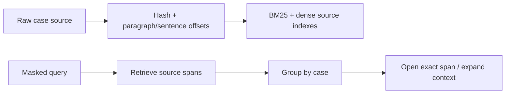
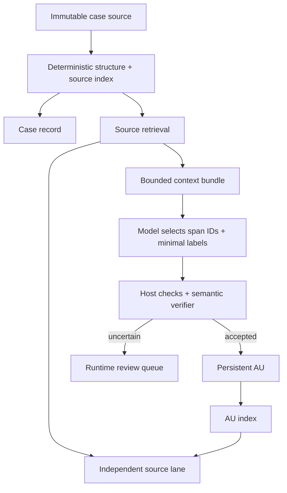
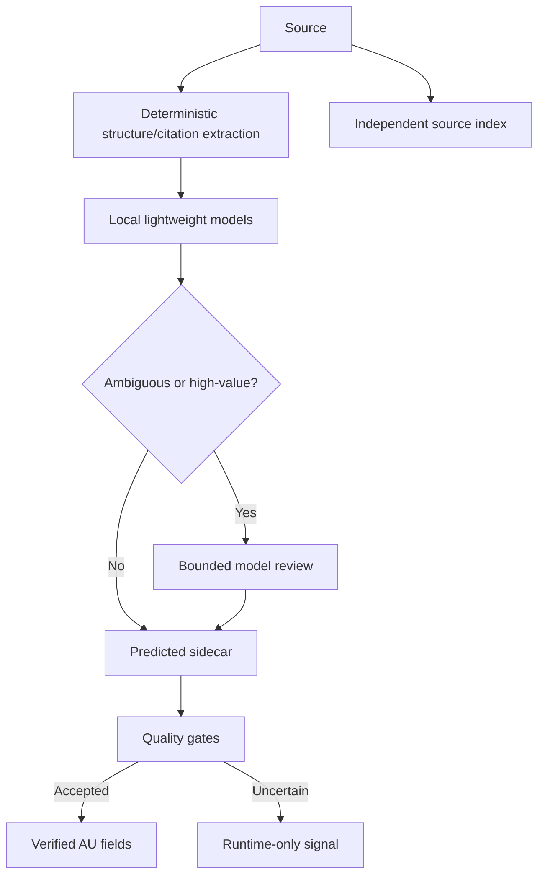

# Báo cáo Agent A — Vòng 1–3

## Kết luận độc lập

Tôi **không đồng ý với giả định rằng chỉ cần bổ sung annotation sidecar hoặc xây KG đầy đủ là sẽ sửa được pipeline hiện tại**.

Bằng chứng trong V13–V15 cho thấy ba vấn đề gốc:

1. **Coverage và omission chưa được kiểm soát.** Model có thể đọc hoặc nhận diện đoạn hữu ích nhưng vẫn không tạo AU.
2. **Đơn vị lựa chọn và hợp đồng phase chưa ổn định.** Pipeline chuyển từ bỏ sót sang chọn gần như toàn bộ văn bản, gây phình schema và lỗi request.
3. **Annotation ngữ nghĩa chưa đủ đáng tin để làm cổng retrieval.** Attribution, qualification và treatment có thể sai dù output hợp schema.

Lynx hỗ trợ mạnh cho các quyết định về **source bất biến, offset, provenance, document part, annotation tách biệt và orchestration có checkpoint**. Nhưng các công trình Lynx không cung cấp bằng chứng rằng một full KG hoặc chuỗi nhiều NLP service sẽ tăng COLIEE recall, giảm token hay xác định treatment chính xác.

Kiến trúc tôi khuyến nghị để Agent B phản biện là:

- Lấy **source-first, dual-index retrieval** làm nền bắt buộc.
- Persistent KB tối thiểu gồm `Case`, source/version, cấu trúc đoạn/câu và các `AU` đã được kiểm chứng.
- Annotation sidecar chỉ là lớp enrichment có thể bỏ, tính lại và không được ngăn source retrieval.
- Trích AU theo kiểu **lazy/selective materialization**, thay vì buộc model đọc và phân loại toàn bộ mọi case khi xây KB.
- Tách rõ:
  - hoàn thành giao thức;
  - coverage cấu trúc;
  - chất lượng ngữ nghĩa;
  - hiệu quả retrieval.

Ký hiệu trong báo cáo:

- **[F] Fact:** đọc trực tiếp từ code, artifact hoặc toàn văn.
- **[I] Inference:** suy luận kỹ thuật từ facts.
- **[P] Proposal:** thiết kế đề xuất.
- **[U] Unknown:** chưa đủ bằng chứng.

---

# 1. Phạm vi và giới hạn bằng chứng

**[F]** Repo được kiểm tra là `G:\Git\coliee-case-retrieval`. `knowledge_base/` và các output V13–V15 đang là nội dung untracked trong checkout hiện tại. Vì vậy đây là bằng chứng filesystem hiện tại, nhưng chưa thể gắn chắc với một commit lịch sử.

**[F]** Source hiện có địa chỉ ổn định dựa trên `source_hash` và offset cho paragraph/sentence tại [source.py](/G:/Git/coliee-case-retrieval/knowledge_base/source.py:207).

**[F]** README tự ghi nhận rằng AU index toàn corpus, NN, Workspace và retrieval chưa được triển khai; `quality_status=not_evaluated` không phải chứng nhận chất lượng. Xem [README.md](/G:/Git/coliee-case-retrieval/knowledge_base/README.md:305) và [README.md](/G:/Git/coliee-case-retrieval/knowledge_base/README.md:477).

**[F]** Năm án calibration chỉ dùng để phân tích lỗi. KOS, agent review và các “locked opportunity” không phải gold độc lập.

---

# 2. Audit V13–V15

## 2.1 Chi phí đo được

Các số dưới đây lấy từ `usage` do provider trả trong raw responses. Đây là token thực báo cáo bởi provider, không phải ước lượng ký tự. Tôi không quy đổi sang USD vì repo chỉ có khoản dự phòng/request, không phải hóa đơn thực.

| Experiment | Phạm vi | Requests | Prompt | Completion | Tổng token | Kết quả |
|---|---:|---:|---:|---:|---:|---|
| V13 local scan | Capability + 3 case | 62 | 290.446 | 23.149 | **313.595** | Hai case complete, một case incomplete |
| V13 — 013948 | Một case | 26 | — | — | **120.801** | 5 AU, 0 brief |
| V13 — 045155 | Một case | — | — | — | **103.262** | Dừng incomplete |
| V13 — 099980 | Một case | — | — | — | **82.785** | Complete nhưng 0 AU/brief |
| V14 direct choices scan fix | Capability + 099980 | 29 | 99.621 | 16.921 | **116.542** | Complete, output rỗng |
| V15 two-stage triage | Capability + 099980 | 71 | — | — | **77.755** | Dừng ở selection review |
| V15 — 099980 | 7 navigation + 53 triage | 60 | — | — | **73.127** | 219 item tạm; chưa classification |

**[I]** V15 đã giảm kích thước request đơn lẻ, nhưng chưa chứng minh giảm chi phí end-to-end: 60 request cho một case và pipeline dừng trước classification/treatment/finalization.

**[I]** Chi phí V13 khoảng 83k–121k token/case cho sample hiện tại. Đây không phải con số có thể ngoại suy thẳng cho corpus vì case, lỗi và số phase khác nhau.

## 2.2 Bảng lỗi

| Triệu chứng | Artifact/request | Pha | Phân loại nguyên nhân | Tác động | Phép kiểm tra |
|---|---|---|---|---|---|
| Model đã nhận diện nhiều đoạn có khả năng là AU nhưng `new_items=[]`; run vẫn hoàn tất rỗng | [V13 checkpoint 099980](/G:/Git/coliee-case-retrieval/knowledge_base/outputs/pilot_v13_extract_before_navigate_local_scan/calibration/099980/checkpoint.json), `responses/*`, final snapshot | Reading, selection, finalizer | **[F]** omission ngữ nghĩa; **[I]** workflow không bắt buộc giải trình từng vùng nguồn | Case không có AU; structured retrieval không thể tìm thấy | Đối chiếu coverage ledger theo paragraph với item refs; review blind từng đoạn bị skip |
| 013948 tạo 5 AU nhưng có AU dạng câu hỏi issue, AU gần trùng và attribution chưa chắc | [V13 final 013948](/G:/Git/coliee-case-retrieval/knowledge_base/outputs/pilot_v13_extract_before_navigate_local_scan/calibration/013948/snapshots/final.json) | Classification/finalizer | **[F]** lỗi semantic selection/label | Nhiễu index; agent có thể hiểu câu hỏi là holding | Independent blinded annotation; duplicate-overlap test |
| 045155 có treatment nhưng không có witness span cho court response | [V13 checkpoint 045155](/G:/Git/coliee-case-retrieval/knowledge_base/outputs/pilot_v13_extract_before_navigate_local_scan/calibration/045155/checkpoint.json) | Treatment | **[F]** thiếu evidence bắt buộc | Treatment dễ phản ánh lời party hoặc cited authority | Yêu cầu hai vai evidence: authority proposition và receiving court response |
| Một số run V13 dừng `invalid_constrained_response` | Các experiment V13 ban đầu và 045155 | Provider/schema decoding | **[F]** lỗi giao thức; nguyên nhân sâu provider hay schema chưa xác định | Retry tốn token; mất checkpoint phase | Replay cùng payload ở endpoint mock; giảm schema riêng từng field |
| V13 linear classification dừng `source_scan_request_limit` | `pilot_v13_extract_before_navigate_linear_classification` | Source scan | **[F]** giới hạn workflow | Dừng trước khi xử lý hết source | Kiểm tra remaining queue tại thời điểm dừng; tăng budget chỉ để đo saturation |
| V14 có response sinh whitespace đến max completion 4.096 | `pilot_v14_anchor_triage`, `pilot_v14_sentence_schema_fix` | Constrained decoding | **[F]** output không hữu dụng; **[U]** lỗi provider hay interaction schema | Trả tiền nhưng không có dữ liệu | Tiny-schema replay; unconstrained diagnostic; log token IDs nếu endpoint hỗ trợ |
| Paragraph và sentence cùng được chọn | `pilot_v14_selection_diagnostic*` | Source selection | **[F]** parent-child overlap | Duplicated source và schema phình | Host canonicalize: child thay parent hoặc parent thay toàn bộ children |
| Small diagnostic chọn heading; large diagnostic bỏ reasoning/disposition đã đánh dấu làm opportunity | `pilot_v14_selection_diagnostic` và `...large_only` | Triage | **[F]** sensitivity theo payload; review label không phải gold | False positive heading và false negative nội dung | Holdout annotation; cùng đoạn đặt trong các context/batch khác nhau |
| V14 099980 đọc lại nhiều window, vẫn complete rỗng | [V14 checkpoint](/G:/Git/coliee-case-retrieval/knowledge_base/outputs/pilot_v14_direct_choices_scan_fix/calibration/099980/checkpoint.json) và [trace](/G:/Git/coliee-case-retrieval/knowledge_base/outputs/pilot_v14_direct_choices_scan_fix/calibration/099980/trace.json) | Reading/navigation | **[F]** workflow lặp nguồn; **[I]** model không có coverage state đủ cô đọng | 116.542 token nhưng không có item | Hash payload source; đo unique-vs-repeated chars/tokens |
| V15 chọn 202/205 paragraph vào ít nhất một lớp, không chọn `refine_sentences` lần nào | [V15 checkpoint](/G:/Git/coliee-case-retrieval/knowledge_base/outputs/pilot_v15_two_stage_triage/calibration/099980/checkpoint.json) | Reader triage | **[F]** over-selection | 125 brief + 94 AU tạm; mất giá trị lọc | Precision/recall paragraph trên holdout; thử abstain và negative examples |
| V15 selection-review schema khoảng 189k ký tự, payload khoảng 244k; HTTP 400 không response body | [V15 failure](/G:/Git/coliee-case-retrieval/knowledge_base/outputs/pilot_v15_two_stage_triage/calibration/099980/failure.json) | Selection review | **[F]** request quá lớn; **[I]** schema/item explosion là nguyên nhân khả dĩ, chưa xác nhận server-side | Pipeline dừng trước semantic validation | Binary search số item; fixed schema + paginated decisions |
| Heading P0000 được chọn `uncertain` dù reasoning nói không phải AU | [V15 first triage response](/G:/Git/coliee-case-retrieval/knowledge_base/outputs/pilot_v15_two_stage_triage/calibration/099980/responses/reader_triage_0.json) | Triage | **[F]** choice không khớp reasoning | “uncertain” biến thành đường giữ lại rác | Host rule cho heading; calibration matrix riêng cho abstention |
| Không có runtime retrieval interface hiện thực | [README.md](/G:/Git/coliee-case-retrieval/knowledge_base/README.md:334) | Sau KB build | **[F]** thiếu implementation | Chưa đo được AU có giúp Recall@K hay không | Xây source-only retrieval trước; sau đó mới ablate AU |
| `completed` và schema-valid bị dùng gần như tín hiệu thành công | Nhiều status/final artifact | Báo cáo | **[F]** status kỹ thuật tách khỏi `quality_status`; **[I]** tiêu chí vận hành dễ che omission | Đánh giá sai pipeline | Bắt buộc báo cáo execution, coverage, semantic, retrieval thành bốn trường riêng |

## 2.3 Chẩn đoán theo lớp lỗi

### Lỗi provider/constrained decoding

- Invalid constrained response.
- Whitespace tới hết completion budget.
- HTTP 400 không body ở V15.

Các lỗi này cần retry có fingerprint, nhưng không nên gộp với lỗi ngữ nghĩa.

### Lỗi schema/payload

- Schema phụ thuộc danh sách item làm kích thước tăng tuyến tính.
- Parent-child overlap.
- Một request toàn bộ 219 item.
- Enum bắt buộc trên mọi paragraph khiến model chọn nhãn positive thay vì skip khi bất định.

### Lỗi workflow

- Đọc lặp window.
- Request limit trước khi queue rỗng.
- Không có contract buộc mỗi đoạn phải có trạng thái cuối.
- Toàn bộ item phải đi qua các phase sau dù confidence thấp.
- Không tách batch completion khỏi case completion.

### Lỗi ngữ nghĩa

- Heading thành brief/AU.
- Issue question thành AU.
- Party argument bị nguy cơ hiểu là court holding.
- Treatment thiếu receiving-court response.
- Bỏ reasoning hoặc disposition.
- Output rỗng dù source scan đã chỉ ra cơ hội.

**Kết luận audit:** “context quá dài” chỉ giải thích một phần. V15 cho thấy context nhỏ vẫn có thể tạo **tổng chi phí lớn và downstream explosion**.

---

# 3. Đọc lại Lynx

## 3.1 Danh mục toàn bộ trang publications

Trang [Lynx publications](https://lynx-project.eu/publications/articles) hiện liệt kê 38 mục nghiên cứu/pending publication. Tôi phân loại như sau.

| Mức | Mục trên trang | Lý do |
|---|---|---|
| **Đọc sâu, trực tiếp hỗ trợ thiết kế** | Building the LKG for Smart Compliance; Curation Technologies; Workflow Manager; Business Requirements; Challenges of Terminology Extraction; Creation and Enrichment of a Terminological KG; Extracting Terminologies; Developing and Orchestrating…; QA for Link Prediction; Fine-Grained NER; Observations on Annotations; Workflow Manager for Complex NLP Pipelines; Orchestrating NLP Services; Lynx: Towards a LKG | Liên quan source model, annotations, NLP services, terminology, orchestration và retrieval |
| **Liên quan phụ** | Linked Open Data of Language Resources; Contractframes; AI Solutions for Legal Terminology; Events in Legal Domain; Spanish Legislation as Linked Data; Annotador; Defying Wikidata; German NER Dataset; Interoperability Roadmap; Abstractive Summarization; Automatic Induction of NE Classes; Domain-independent semantic measure; Terminologies and Ontologies | Có thể hỗ trợ component cụ thể, nhưng không trực tiếp chứng minh thiết kế COLIEE |
| **Loại khỏi quyết định kiến trúc chính** | TERECOM proceedings 2017/2018; LREC Legal KG proceedings trùng; TIAD results/proceedings; OntoLex dictionary validation; Linked Democracy; cross-lingual dictionary embeddings; Globalex proceedings; trust/privacy/governance paper | Proceedings tổng hợp, translation/lexicography hoặc governance; không giải quyết coverage, attribution hay token của case retrieval |

Việc loại khỏi thiết kế không có nghĩa các bài này kém chất lượng; chỉ là chúng không phân xử được lựa chọn pipeline hiện tại.

## 3.2 Phiếu đọc sâu

### A. Developing and Orchestrating a Portfolio of Natural Legal Language Processing and Document Curation Services, 2019

Nguồn: [ACL Anthology PDF](https://aclanthology.org/W19-2207.pdf).

- **Bài toán:** danh mục 13 dịch vụ legal NLP và cách ghép chúng thành workflow.
- **Đầu vào/đầu ra:** document → annotations, terms, entities, concepts, references, structure, summaries, relations; orchestration qua HTTP/OpenAPI.
- **Bằng chứng:**
  - Terminology extraction tạo term, context và source reference; dùng TF-IDF/co-occurrence, §3.1, PDF tr. 2.
  - NER dùng corpus án Đức, 19 class; Table 1, §3.3, PDF tr. 3.
  - Legal reference resolution dùng pattern được seed và xác nhận bán tự động, §3.7, PDF tr. 5.
  - Text structure dựa nhiều vào pattern/regex và tác giả ghi nhận robust structure vẫn là vấn đề nghiên cứu, §3.8, PDF tr. 5.
  - KG population khi đó mới thử các relation chung như `located-in`/`contained-in`, §3.11, PDF tr. 7.
  - Workflow chạy qua microservice, Camunda hoặc message queue; có sync/async và song song, §4, PDF tr. 8–9.
- **Giới hạn:** phần lớn là mô tả service/prototype. Không có đánh giá COLIEE, token cost, attribution/treatment hay end-to-end retrieval.
- **Khả năng chuyển:** cao cho modular contracts, provenance và thay thế component; thấp cho việc biện minh full KG.
- **Quyết định được hỗ trợ:** mỗi annotation phải có source/provenance; service phải có input/output contract; component có thể thay thế.
- **Không hỗ trợ:** “càng nhiều service càng tốt” hoặc “KG sẽ tự tăng retrieval quality”.

### B. Orchestrating NLP Services for the Legal Domain, 2020

Nguồn: [toàn văn arXiv](https://arxiv.org/pdf/2003.12900).

- **Bài toán:** platform quản lý document, annotation và workflow dịch vụ legal NLP.
- **Điểm hữu ích:**
  - Document Manager hỗ trợ document/annotation CRUD, JSON-LD/RDF, ElasticSearch, NIF offsets và query theo annotations, §§4.2, PDF tr. 4–5.
  - Workflow Manager biểu diễn quy trình thành task/process/job, giữ state trong PostgreSQL và dữ liệu lớn trong shared document store, §4.3, PDF tr. 5–6.
  - Annotation được thu lại thành enriched document, nhưng document gốc vẫn là đối tượng riêng.
- **Giới hạn:** abstract và introduction nói hệ thống đang phát triển; các pilot chưa vận hành tại thời điểm bài viết. Phần cuối để deployment/evaluation cho tương lai.
- **Khả năng chuyển:** hỗ trợ checkpoint, immutable source, resumable per-task execution và tách orchestration khỏi NLP model.
- **Không hỗ trợ:** độ tin cậy thực tế của chuỗi dịch vụ hoặc lợi ích kinh tế khi dùng nhiều phase.

### C. Fine-Grained Named Entity Recognition in Legal Documents, 2019

Nguồn: [DFKI PDF](https://www.dfki.de/fileadmin/user_upload/import/10980_Leitner2019_Chapter_Fine-GrainedNamedEntityRecogni.pdf).

- **Dữ liệu:** 750 quyết định tòa Đức; 66.723 câu, khoảng 2,16 triệu token và 53.632 entity; 19 class, §4 và Table 1, PDF tr. 6–7.
- **Kết quả:** BiLSTM đạt khoảng 95,46 F1 fine-grained và 95,95 coarse; CRF thấp hơn; §§5–6 và các bảng kết quả, PDF tr. 8–11.
- **Hạn chế quan trọng:**
  - Một annotator chính; IAA chưa được báo cáo trong bài.
  - Evaluation xáo trộn theo câu và 10-fold, không phải document-held-out.
  - Class imbalance lớn; LAW và COURT_DECISION chiếm phần đáng kể.
  - Citation formula đồng nhất giúp kết quả; citation không chuẩn gây boundary/class errors.
- **[I]** Kết quả có thể lạc quan khi chuyển sang án Canada và khi split theo document. Đây là suy luận domain-transfer, không phải kết luận của tác giả.
- **Khả năng chuyển:** mô hình/entity recognizer có thể tạo candidate citation/court/statute mention. Không nên dùng NER output làm kết luận authority, treatment hoặc noticed case.
- **License:** bài nói dataset CC BY; metadata repository hiện có dấu hiệu license khác. Cần kiểm tra trực tiếp trước khi tái sử dụng model/dataset.

### D. LKG specification

Nguồn: [LKG specification v1.2](https://lynx-project.eu/doc/lkg/).

- `LynxDocument` có text, metadata, parts và annotations.
- Part trỏ vào vùng văn bản bằng offsets thay vì lặp lại text.
- Annotation có context, offsets/anchor, annotator reference, class reference, external identity và confidence.
- Validation yêu cầu document/text và offset nhất quán.

**Áp dụng phù hợp:**

- Giữ source bất biến.
- `SourcePart` và annotation trỏ bằng offset.
- Gắn `annotator`, `model_version`, `created_at`, `confidence`.
- Khi source hash đổi, annotation cũ hết hiệu lực.

**Không nên sao chép nguyên bản:**

- RDF/JSON-LD và ontology đầy đủ chưa có bằng chứng cần thiết cho pilot.
- LKG validation chủ yếu bảo đảm cấu trúc/provenance; không chứng minh legal semantics.

### E. Extracting terminologies in the legal domain

Nguồn: [toàn văn/metadata ResearchGate](https://www.researchgate.net/publication/337566072_Extracting_terminologies_in_the_legal_domain_a_syntactic_pattern-based_approach_for_Spanish).

- Corpus khoảng 0,5 triệu token, Spanish labour law/collective agreements.
- Phương pháp dùng noun-phrase syntactic patterns.
- Một số pattern thu hồi khoảng 91% term trong corpus/glossary comparison.
- Bài tự gọi đây là preliminary work.
- `termhood`, biến thể thuật ngữ và expert validation nằm ngoài scope; §§1, 4, 5.

**Đánh giá:** 91% là mức bao phủ pattern trong bài toán terminology của corpus Tây Ban Nha. Nó không phải precision concept, entity linking accuracy hoặc legal retrieval recall. Với COLIEE, terminology nên là tín hiệu query expansion mềm.

### F. Creation and Enrichment of a Terminological KG

Nguồn: [CEUR PDF](https://ceur-ws.org/Vol-2598/paper-07.pdf), [UPM record](https://oa.upm.es/67256/).

- Đề xuất sáu task: refinement, disambiguation, enrichment, relation validation, relation extraction và RDF conversion.
- Áp dụng hướng nghiên cứu trên corpora contracts và collective agreements.
- Abstract dùng future/result framing cho Terminological KG.

**Giới hạn:** trong môi trường đọc hiện tại tôi chỉ truy cập chắc chắn được abstract/metadata, không có đủ toàn văn trích xuất để xác minh bảng đánh giá. Theo yêu cầu của nghiên cứu, tôi **không dùng bài này làm bằng chứng hiệu quả**. Nó chỉ hỗ trợ việc tách term candidate, disambiguation, validation và publication thành các bước khác nhau.

### G. Question Answering for Link Prediction and Verification

Nguồn: [Springer chapter](https://link.springer.com/chapter/10.1007/978-3-030-32327-1_23).

- Bài 5 trang, đề xuất dùng QA để nhận diện khoảng trống KG và tìm evidence ngoài KG.
- Trang Springer chỉ cung cấp abstract và ghi “preliminary results”; toàn văn bị giới hạn truy cập.
- Vì vậy không dùng bài này để biện minh rằng QA/KG completion có hiệu quả thực nghiệm cho COLIEE.

Điều có thể dùng ở mức ý tưởng: một relation dự đoán cần evidence passage để kiểm chứng. Điều không thể dùng: link prediction tự tạo quan hệ pháp lý đáng tin.

### H. Deliverables

- [D3.8 Summarisation and annotation services](https://zenodo.org/records/3865668) mô tả NER, TIMEX, GEO, summarisation; metadata nói rõ dù là final report, service vẫn tiếp tục được phát triển và đánh giá.
- [D3.9 Information Retrieval and Recommender Services](https://zenodo.org/records/3870457) mô tả Search, Terminology Query, QA và Semantic Similarity; service đã được containerize nhưng một số vẫn là ongoing research.
- [Danh mục deliverables](https://lynx-project.eu/publications/deliverables) còn có D3.6 extraction/linking và D5.8 evaluation report, nhưng tôi chưa lấy được toàn văn đủ tin cậy để trích metric.

**Kết luận:** “implemented/containerized” là trạng thái kỹ thuật. Nó không đồng nghĩa đã chứng minh quality, portability hay cost-effectiveness.

---

# 4. Những gì Lynx thực sự hỗ trợ cho COLIEE

| Kết luận | Mức bằng chứng |
|---|---|
| Giữ source riêng, immutable, có version/hash | Mạnh: LKG spec và Document Manager |
| Part/annotation dùng offsets và provenance | Mạnh: LKG spec |
| NLP service nên có contract và thay thế độc lập | Mạnh: hai bài orchestration |
| Annotation nên tách khỏi source | Mạnh |
| Citation/NER có thể sinh candidate | Trung bình; kết quả tốt trên German corpus nhưng transfer chưa biết |
| Terminology có thể giúp query expansion | Trung bình/thấp; bằng chứng chủ yếu Spanish terminology |
| Full KG tăng COLIEE recall/F1 | Không có |
| Multi-service workflow giảm token/lỗi | Không có |
| Relation linking xác định treatment/holding | Không có |
| Summarization an toàn thay source | Không có |

**[I]** Đóng góp quan trọng nhất của Lynx cho bài toán hiện tại là **data contract và component isolation**, không phải ontology hay số lượng annotation.

---

# 5. Baseline bắt buộc: source-only, ít pha, không annotation

Baseline phải được triển khai trước để tránh đánh giá enrichment mà không có đối chứng.



## Persistent

- `Case(case_id, source_uri, source_hash, metadata)`
- Immutable raw text.
- Paragraph/sentence manifest với offsets.
- BM25 và dense indexes có thể tái tạo.

## Runtime

- Query đã che citation.
- Candidate source spans.
- Case aggregation.
- Opened spans và coverage ledger.

## Không có

- AU.
- Concept KG.
- Treatment hoặc speaker annotation.
- Query-time access tới unmasked/gold citation.

## Vai trò

- **Host:** parsing, hashing, indexing, retrieval, exact-span materialization.
- **Model:** chỉ đọc candidate spans khi downstream cần; không dùng khi build baseline.
- **Tool:** `search_source`, `get_case`, `open_span`, `expand_context`.

Baseline này là hàng rào chống việc AU thiếu hoặc concept sai làm case biến mất.

---

# 6. Thiết kế 1 — Tổ chức tri thức tối thiểu

## 6.1 Quyết định kiến trúc

**[P]** Dùng `Case + verified AU`, nhưng AU được materialize **có chọn lọc/lazy**, không buộc extract toàn corpus ngay từ đầu.



## 6.2 Persistent data

### `Case`

```text
case_id
source_version
source_hash
source_location
metadata
paragraph_manifest[]
sentence_manifest[]
optional_case_brief_refs[]
au_ids[]
```

Case brief chỉ là trợ giúp có evidence refs, không thay nguồn.

### `AuthorityUnit`

```text
au_id
case_id
source_version
source_refs[]          # exact offsets
function               # rule | condition | exception | application |
                       # evidence_reasoning | procedure | disposition
speaker_role           # court | party | witness | quoted_authority | unknown
status                 # accepted | provisional | rejected
confidence
extraction_provenance
verification_provenance
```

Không bắt buộc mọi paragraph thuộc một AU. AU không phải partition của judgment.

## 6.3 Derived data

- Source lexical/dense index.
- AU lexical/dense index.
- Duplicate/overlap clusters.
- Materialized excerpts.
- Coverage and quality statistics.

Tất cả derived data phải tái tạo được từ source và accepted records.

## 6.4 Runtime data

- Query workspace.
- Opened spans.
- Candidate pool.
- Coverage/open questions.
- Provisional claims.
- Actions, budget, retry state, stop reason.

Runtime interpretation không trở thành canonical AU chỉ vì agent đã tạo.

## 6.5 Luồng host/model/tool

1. Host hash source và tạo offsets.
2. Host index toàn bộ source, không gọi model.
3. AU được tạo khi:
   - case xuất hiện thường xuyên trong retrieval;
   - source-only retrieval mở một passage có giá trị;
   - calibration/build budget chủ động chọn case.
4. Host gửi model một bundle bounded:
   - paragraph hiện tại;
   - paragraph trước/sau;
   - heading;
   - local citation mentions;
   - không gửi toàn bộ case.
5. Model chỉ chọn source IDs và nhãn tối thiểu.
6. Host materialize exact text và kiểm tra offset/hash.
7. Verifier kiểm tra attribution, điều kiện và duplicate.
8. Accepted AU được cache và index; provisional AU không được làm hard filter.

## 6.6 Context expansion

`expand_context` hoạt động theo paragraph boundary:

- `previous(1..n)`;
- `next(1..n)`;
- containing section;
- all mentions của cùng citation trong case;
- court-response search sau một quoted authority.

Không dùng fixed character window làm contract duy nhất.

## 6.7 Omission check

Mỗi paragraph có một trạng thái vận hành:

```text
unseen
examined_no_item(reason)
selected
uncertain
error
superseded_by_child
```

Coverage không chứng minh semantic completeness, nhưng ngăn silent omission.

Sau mỗi case:

- paragraph chưa có trạng thái → run không complete;
- heading-only item → reject;
- parent-child overlap → canonicalize;
- citation mention không có surrounding court response → unresolved;
- AU có `condition/exception` nhưng không có predecessor/context evidence → provisional;
- treatment chỉ có cited proposition mà không có receiving-court response → provisional.

## 6.8 Error/resume

Checkpoint theo `(case_id, source_hash, stage, batch_id, prompt/tool version)`.

- Provider failure: retry đúng batch.
- Invalid schema: lưu raw response, không áp dụng mutation.
- Semantic uncertainty: lưu provisional, không retry vô hạn.
- Source hash đổi: invalidate AU và indexes liên quan.
- Resume phải idempotent theo operation ID.

## 6.9 Điểm yếu

- AU của case ít được truy cập xuất hiện muộn.
- Source-only index phải đủ mạnh trong giai đoạn đầu.
- Verifier attribution/treatment vẫn có thể sai.
- Lazy materialization làm chất lượng KB không đồng đều.

## 6.10 Falsification tests

Bác bỏ thiết kế tối thiểu nếu:

- Source-only + lazy AU làm Recall@100 thấp hơn build-all AU một cách có ý nghĩa trên holdout.
- Query lặp lại không đủ nhiều để bù chi phí tạo AU.
- Provisional/accepted AU có omission hoặc attribution error vượt ngưỡng đã khóa.
- Cases không có AU bị giảm recall sau merge.

---

# 7. Thiết kế 2 — Enrichment có chọn lọc bằng sidecar

## 7.1 Annotation sidecar là gì trong thiết kế này

Sidecar là dữ liệu dự đoán tách khỏi source và AU canonical:

```text
annotation_id
case_id
source_version
start/end
annotation_type
value
confidence
annotator/tool/version
status              # predicted | reviewed | rejected
evidence_refs[]
dependencies[]
```

Các loại có thể thử:

- `citation_mention`;
- `authority_identity`;
- `speaker_role`;
- `legal_function`;
- `condition_or_exception`;
- `court_response`;
- `treatment_candidate`;
- `concept_candidate`;
- `document_structure`.

Sidecar không được ghi đè source và không tự biến thành kết luận pháp lý.

## 7.2 Pipeline phân tầng



### Tier 0 — deterministic

- Hash, offsets, headings.
- Citation-string candidate extraction.
- Paragraph/sentence boundaries.
- Duplicate detection.
- No legal semantic claims.

### Tier 1 — local/cheap models

- NER for case/court/statute/person.
- Speaker and paragraph-function classifier.
- Concept candidates.
- Output luôn `predicted`.

### Tier 2 — model review

Chỉ chạy khi:

- speaker ambiguous;
- paragraph có party/court conflict;
- qualification nằm ngoài selected span;
- cited authority và court response cách xa;
- candidate treatment ảnh hưởng downstream;
- concept linker có margin thấp;
- source dài và các Tier 0/1 signal bất đồng.

### Tier 3 — AU acceptance

Sidecar chỉ được chuyển thành AU field sau evidence validation. Treatment cần tối thiểu:

1. proposition/authority mention;
2. receiving court response;
3. exact spans cho cả hai;
4. confidence và unresolved conditions.

## 7.3 Selective enrichment policy

Ưu tiên case:

- được retrieval mở nhiều lần;
- có source dài;
- có nhiều citation mentions;
- source index và AU index bất đồng;
- model thường cần mở rộng context;
- có tỷ lệ provisional cao.

Không enrich chỉ vì source dài. Case dài nhưng ít AU vẫn được source retrieval bao phủ.

## 7.4 Lợi ích dự kiến

- Có thể giảm text phải gửi lại cho model khi cùng case được dùng nhiều lần.
- Speaker/condition/court-response candidates giúp model mở đúng context.
- Term/concept candidates hỗ trợ query expansion.
- Sidecar có provenance và có thể tính lại khi tool thay đổi.

Đây đều là **[P]/[I]**, chưa phải hiệu quả đã đo.

## 7.5 Rủi ro

- Metadata sai tạo cảm giác chắc chắn giả.
- Concept sai kéo query khỏi authority thực.
- Model phụ tăng dependency, cache invalidation và lỗi version.
- Full sidecar cho mọi paragraph có thể đắt hơn việc đọc source khi số lần tái sử dụng thấp.
- Treatment dự đoán dễ làm mất adverse authority nếu dùng làm filter.

## 7.6 Falsification tests

Loại từng annotation type nếu:

- Không tăng Recall@K hoặc giảm token end-to-end trên holdout.
- Error attribution/treatment cao hơn source-only reading.
- Retry/build cost lớn hơn token tiết kiệm sau số lần reuse thực tế.
- Case không annotation bị giảm xác suất xuất hiện.
- Annotation confidence không được calibration.
- Model có xu hướng tin sidecar hơn exact source khi hai bên xung đột.

---

# 8. So sánh ba phương án

| Thuộc tính | Source-only baseline | Minimal Case + lazy AU | Selective sidecar |
|---|---|---|---|
| Build token | Gần 0 model token | Thấp đến trung bình | Trung bình đến cao |
| Coverage toàn corpus | Mạnh | Mạnh nếu giữ source lane | Mạnh chỉ khi source lane độc lập |
| Context tiết kiệm | Thấp | Trung bình | Có thể cao |
| Attribution support | Không | Chỉ AU được kiểm chứng | Có candidate + confidence |
| Rủi ro concept drift | Thấp | Thấp | Cao hơn |
| Khả năng resume | Đơn giản | Vừa | Phức tạp |
| Dependency | Indexer | Indexer + verifier | Nhiều model/tool |
| Bằng chứng Lynx | Document/index model | Document + annotation provenance | Modular services nhưng chưa có COLIEE efficacy |
| Khuyến nghị | Baseline bắt buộc | **Mặc định khuyến nghị** | Ablation, không bật toàn bộ |

---

# 9. Break-even

Gọi:

- \(E_m\): chi phí build minimal.
- \(E_s\): chi phí build sidecar.
- \(R_m\): token trung bình mỗi query với minimal.
- \(R_s\): token trung bình mỗi query với sidecar.
- \(F_m,F_s\): token retry/sửa lỗi kỳ vọng.
- \(n\): số lần KB được tái sử dụng.

Sidecar hòa vốn khi:

\[
n \geq
\frac{E_s-E_m}
{(R_m+F_m)-(R_s+F_s)}
\]

Nếu mẫu số không dương thì sidecar không hòa vốn dù reuse bao nhiêu lần.

Không được tính tiết kiệm từ:

- case bị bỏ sót;
- dừng sớm do lỗi;
- không chạy verifier;
- không mở source khi cần;
- giảm Recall@K.

Các V13–V15 hiện không đủ để ước lượng break-even vì chúng chưa chạy cùng contract, cùng quality và cùng retrieval workload.

---

# 10. Xử lý các tình huống bắt buộc

| Tình huống | Cách xử lý |
|---|---|
| Đoạn không citation nhưng có lập luận hữu ích | Source index luôn bao phủ; AU selection không yêu cầu citation |
| Lời party bị hiểu thành lời tòa | `speaker_role=unknown/provisional` nếu thiếu attribution evidence; mở predecessor/heading |
| Điều kiện ở đoạn trước | AU phải lưu nhiều source refs hoặc context dependency; không cắt paragraph độc lập |
| Court response nằm xa | Tool tìm các mention cùng authority và mở forward context theo section/budget |
| Concept sai | Concept là query-expansion signal; không hard filter |
| Source dài nhưng ít AU | Không ép quota AU; source lane bảo đảm discoverability |
| Citation trong query bị che | Chỉ dùng masked query; cấm unmasked/gold trong build/runtime retrieval |
| Output hợp schema nhưng bỏ sót | Coverage ledger + semantic omission evaluation; schema pass không đủ |
| Citation bị che trong một đoạn source | Tìm bằng proposition/concept/source text; không khôi phục từ gold |
| Case bị distinguish/reject | Vẫn retrieval-relevant; treatment không phải relevant/irrelevant |
| Annotation thiếu hoàn toàn | Case vẫn có trong source index |
| AU sai | AU index chỉ là lane phụ; user/agent có thể mở exact source và sidecar provenance |

---

# 11. Retrieval interface tối thiểu phải chốt

```text
search_source(query, k, filters?) -> SourceHit[]
search_au(query, k, filters?) -> AUHit[]
get_case(case_id, source_version?) -> Case
open_span(case_id, source_hash, start, end) -> ExactSource
expand_context(span_ref, direction, paragraph_budget) -> SourcePart[]
get_annotations(span_ref, types?, statuses?) -> Annotation[]
```

Mỗi hit bắt buộc có:

```text
case_id
source_hash/source_version
evidence_ref
retrieval_lane
score
index_version
```

Merge source/AU phải giữ quota độc lập trước khi hợp nhất để AU-rich cases không lấn hết kết quả. Việc chọn tập án cuối/reranking nằm ngoài phạm vi vòng này.

---

# 12. Kế hoạch thí nghiệm để phân xử

## Arms

- **B0:** source-only.
- **B1:** source + lazy verified AU.
- **B2:** B1 + deterministic citation/structure sidecar.
- **B3:** B2 + speaker/function annotation.
- **B4:** B3 + terminology/concept candidates.
- **B5:** B4 + treatment candidate.

Không thử full sidecar như một gói duy nhất; nếu thắng sẽ không biết thành phần nào có ích.

## Metrics

### Cấu trúc

- Offset/hash exactness.
- Source immutability.
- Invalidation.
- Idempotent resume.
- Local failure isolation.

### Ngữ nghĩa

- AU omission.
- Missing condition.
- Speaker attribution.
- Treatment accuracy.
- Parent-child duplicate.
- Heading false positive.
- Court-response evidence completeness.

### Hiệu quả

- Build tokens và requests.
- Query-time tokens và requests.
- Retry/repair tokens.
- Latency.
- Completed-run và failed-run báo riêng.
- Unique source characters so với repeated characters.

### Retrieval

- Recall@50/100/200 cho source-only, AU-only và combined.
- Per-case contribution của từng lane.
- Recall của cases không có AU.
- Final micro-F1 chỉ đánh giá downstream sau.

## Evaluation discipline

- Năm case hiện có: calibration/error analysis.
- Khóa một holdout riêng trước khi chỉnh prompt/policy.
- Người đánh giá không thấy gold noticed case khi annotation.
- Agent review/KOS labels chỉ là hypotheses.
- Mục tiêu giảm 30% token chỉ được công nhận nếu semantic quality và Recall@K tương đương trong khoảng sai số đã khóa.

---

# 13. Quyết định chuyển Agent B phản biện

Tôi đề nghị Agent B tập trung phản bác tám điểm sau:

1. Lazy AU có thật sự rẻ hơn build-all khi tính query reuse không?
2. Coverage ledger có tạo overhead lớn mà vẫn không bắt được semantic omission không?
3. Một verifier riêng có cải thiện attribution/treatment đủ để bù thêm request không?
4. Context `current ± adjacent paragraphs` có đủ cho court response xa không?
5. Source/AU dual lane có tăng request và latency quá mức không?
6. Annotation type nào có lợi ích thực sự, loại nào chỉ làm schema phình?
7. Fixed retrieval interface trên có đủ để thay đổi extractor/model mà không migration lớn không?
8. V15 thất bại do schema explosion hay endpoint/provider; phép thử nhỏ nhất nào phân xử?

## Quyết định hiện tại của Agent A

- **Chấp nhận:** immutable source, offsets/hash, provenance, independent source index, exact-span opening, checkpoint idempotence.
- **Chấp nhận có điều kiện:** `Case + AU`, với AU không exhaustive và source lane luôn tồn tại.
- **Đưa vào ablation:** citation/entity/speaker/condition/concept sidecars.
- **Chưa chấp nhận:** full KG, global concept linking, treatment-as-filter, multi-service workflow mặc định.
- **Bác bỏ:** dùng completion/schema validity làm quality signal; bắt mọi case tạo số AU tối thiểu; cho annotation quyết định case có được retrieval hay không.

Không có file nào được sửa và không có inference trả phí nào được chạy.
