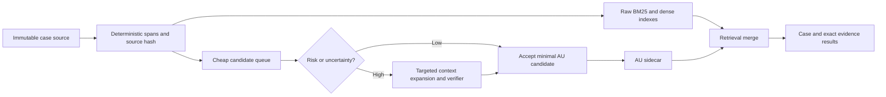

# Báo cáo Agent B — Vòng 1–3

Tôi đã audit độc lập repo chính, chưa xem thiết kế Agent A. Tôi chỉ đọc file và nguồn công khai; không sửa file, không gọi inference trả phí. Working tree đã có các file deleted/untracked từ trước; tôi không thay đổi trạng thái đó.

## 1. Kết luận chính

Tôi không đồng ý với giả định rằng nhược điểm chủ yếu của V13–V15 là “context quá dài”. Bằng chứng cho thấy ba vấn đề khác nghiêm trọng hơn:

1. **Candidate discovery bị gộp với materialization.** V15 buộc mỗi đoạn phải thành `brief`, `AU`, `both`, `uncertain` hoặc `skip`. Model không dùng `skip` lần nào, làm 205 đoạn biến thành 219 item trước khi có bước xác nhận chất lượng.
2. **Schema tăng theo số source/item.** V13 từng tăng gần bậc hai ở classification; V15 tạo schema review 189.170 ký tự cho 219 item. Chia source thành batch nhỏ chỉ chuyển điểm nghẽn sang pha sau.
3. **Pipeline dùng model cho nhiều quyết định có thể tách hoặc trì hoãn.** Navigation, source selection, materialization, classification, treatment và finalization đều có thể lặp source hoặc làm tăng request. Nhiều pha không bổ sung đủ thông tin mới để bù chi phí và xác suất lỗi.

Kiến trúc tôi khuyến nghị:

- Giữ **raw source bất biến và searchable độc lập** làm đường bảo vệ coverage.
- Tách `candidate` khỏi `AU đã chấp nhận`.
- Dùng schema cố định theo batch, không sinh một field cho từng item/source của cả case.
- Chỉ gọi bước xác minh sâu khi có rủi ro attribution, qualifier, treatment hoặc evidence xa.
- Lưu enrichment dưới dạng sidecar có thể invalidation/rebuild; không bắt retrieval phụ thuộc vào annotation.
- Chưa có bằng chứng để dựng full RDF KG, Camunda/microservice stack hoặc chạy NER/terminology trên toàn corpus.

---

# 2. Audit V13–V15

## 2.1 Bảng lỗi

| Lớp lỗi | Triệu chứng và bằng chứng | Nguyên nhân | Tác động | Cách phân xử |
|---|---|---|---|---|
| Provider | V13 có 20, V14 có 58, V15 có 30 lượt HTTP 503 warmup. Một call V13 cần 21 transport attempts; V14 tối đa 32 | Replica chưa sẵn sàng; endpoint retry 503 trong cùng logical request | Tăng latency, nhưng không làm sai nghĩa trực tiếp | Báo riêng logical request và transport attempt; không gọi 503 là semantic retry |
| Endpoint/request | V15 `selection_review` trả HTTP 400 sau khoảng 36,9 giây, không có response body | Schema/payload rất lớn là giả thuyết mạnh, chưa xác nhận limit cụ thể | Case dừng trước classification | Preflight theo bytes/schema/tokens và probe kích thước; 400 không retry cùng payload |
| Constrained generation | Hai thử nghiệm V14 sentence schema từng sinh khoảng trắng đến hết token; direct-key diagnostic sau đó trả được lựa chọn câu | Phụ thuộc cách biểu diễn schema/model, không đơn thuần là source dài | Request technically complete hoặc bị cắt nhưng không mang quyết định hữu ích | Probe đúng schema thực, có negative examples; kiểm tra non-whitespace content |
| Schema | V14 cho paragraph và sentence cùng tồn tại trong schema; host mới phát hiện overlap | JSON Schema không biểu diễn được phụ thuộc cha–con | Response schema-valid vẫn bị host bác | Chỉ đưa một mức hạt trong mỗi request hoặc dùng action cố định với host validation |
| Schema | V13 classification cũ gắn role/attribution theo item × source | Kích thước tăng gần bậc hai | HTTP 400 ở experiment compact scan | Hoist attribution theo source như V14 hoặc phân batch; không dùng schema toàn-case |
| Schema | V15 tạo một decision bắt buộc cho mỗi trong 219 item | Dynamic global schema | 189.170 ký tự schema, 244.508 ký tự endpoint payload | Batch item cố định và preflight hard cap |
| Workflow control | V13 linear classification chạm trần 24 source scans vì AU cũ được rà gần toàn bộ source mới | Mỗi item mở rộng độc lập, thiếu dedup theo evidence need | Request tăng mà coverage nghĩa không tăng tương ứng | Lập queue theo source/evidence gap; một span được đọc một lần cho nhiều item |
| Workflow control | `099980` V13 hoàn tất rỗng dù batch assessment đã chỉ ra cơ hội; chỉ đọc khoảng 43% source | Navigation và materialization tách rời không bảo đảm cơ hội được chuyển thành item | False empty result | `complete` phải tách khỏi `semantic_coverage`; raw fallback luôn còn |
| Workflow control | `045155` tìm evidence “authority applies” nhưng không có court response; host bác treatment | Evidence contract yêu cầu hai phía nhưng navigation không bảo đảm thu thập phía tòa | Case incomplete dù source gần được đọc hết | Mỗi treatment task phải có `authority_witness` và `current_court_witness`, hoặc `unknown` |
| Semantic | `013948` hoàn tất với 5 AU nhưng review cho thấy một item gần brief/issues, hai item gần duplicate và attribution đáng ngờ | Schema đúng không kiểm tra độc lập pháp lý, speaker hay redundancy | KB có thể tăng noise retrieval | Gold-blind semantic review và duplicate/attribution metrics |
| Semantic | V14 large paragraph-only tìm 1/3 cơ hội; small batch tìm 3/3 nhưng từng chọn nhầm heading hoặc parent–child overlap | Batch nhỏ cải thiện local recall nhưng không chứng minh precision hay toàn-case recall | Không thể suy ra “batch 4 giải quyết selection” | Đánh giá toàn-case với negatives và omission, không chỉ locked positives |
| Semantic | V15 giữ `P0204` thành AU thay vì brief disposition | Triage bắt buộc chọn loại trước khi có bước xác minh | Sai kind dù opportunity được “giữ” | Candidate chỉ mang span và reason; kind chỉ được gán sau verification |

Tài liệu repo tự ghi rõ `completed` chỉ là trạng thái thực thi và `quality_status=not_evaluated` tại [README.md](G:/Git/coliee-case-retrieval/knowledge_base/README.md:15). Phân tích V15 xác nhận 205 đoạn, 219 item và HTTP 400 tại [099980_failure_analysis.md](G:/Git/coliee-case-retrieval/knowledge_base/outputs/pilot_v15_two_stage_triage/099980_failure_analysis.md:9).

## 2.2 Chi phí đo từ provider usage

Các token dưới đây lấy từ `usage` trong raw provider response, vì vậy là số đo thực của provider. “Source chars” là tổng ký tự source tìm thấy trong payload journal, dùng để đo lặp source; đây không phải token.

### Theo case

| Version/case | HTTP 200 | Prompt tokens | Completion tokens | Tổng token | Coverage/source lặp | Kết quả |
|---|---:|---:|---:|---:|---|---|
| V13 `013948` | 26 | 111.122 | 9.679 | 120.801 | Khoảng 99% source; 164.583 source chars được truyền qua các pha | Complete; 5 AU, nhưng có lỗi nghĩa trong review |
| V13 `045155` | 16 | 95.725 | 7.537 | 103.262 | Khoảng 98%; 163.665 source chars | Incomplete ở treatment |
| V13 `099980` | 11 | 78.950 | 3.835 | 82.785 | Khoảng 43%; 144.366 source chars do các window bị lặp/chồng | Complete nhưng empty |
| V14 `099980` | 18 | 93.095 | 13.359 | 106.454 | 7/14 window; 151.513 source chars, lớn hơn source 121.985 chars | Host-finalized empty |
| V15 `099980` | 60 thành công + 1 HTTP 400 | 56.149 | 16.978 | 73.127 trước request lỗi | Đã triage đủ 121.985 chars; review lại mang gần toàn source lần hai | Dừng trước classification |

V15 dùng ít prompt token hơn V14 nhưng không thể gọi là tiết kiệm: pipeline chưa tạo kết quả cuối, completion token cao và request review bị bác trước khi có usage.

### Theo experiment, gồm capability probes

| Experiment | Logical calls | Transport attempts | Prompt | Completion | Transport latency đo được |
|---|---:|---:|---:|---:|---:|
| V13 local scan | 62 HTTP 200 | 82 = 62×200 + 20×503 | 290.446 | 23.149 | 128,84 s |
| V14 direct choices | 29 HTTP 200 | 87 = 29×200 + 58×503 | 99.621 | 16.921 | 89,14 s |
| V15 two-stage | 71 HTTP 200 + 1×400 | 102 = 71×200 + 30×503 + 1×400 | 58.115 | 19.640 | 162,02 s |

Không experiment nào trên có logical repair/retry. Retry quan sát được là transport-level 503 warmup. V15 tốn riêng khoảng 36,84 giây cho request 400 không trả kết quả.

Khoản `0,25 USD/request` trong README là **reserve nội bộ để chặn budget**, không phải giá provider đo được; chính README cũng nói rõ điều này tại [README.md](G:/Git/coliee-case-retrieval/knowledge_base/README.md:95).

## 2.3 Payload, schema và text lặp

| Case/phase | Payload journal | Schema | Source text |
|---|---:|---:|---:|
| V13 `013948` reader extract | 78.087 chars | 6.667 | 50.346 |
| V13 `013948` selection extract | 85.095 | 10.076 | 50.982 |
| V13 `013948` source scan | 82.084 | 6.468 | 23.487 |
| V14 `099980` reader extract | 289.972 | 76.365 | 124.794 |
| V14 `099980` selection extract | 63.284 | 16.862 | 26.719 |
| V15 `099980` triage | 187.629 | 29.867 | 121.985 |
| V15 `099980` selection review | 466.713 | 189.170 | 121.985 |

Các con số là tổng artifact theo pha, ngoại trừ request V15 review là một request toàn-case. Chúng cho thấy:

- V13 lặp source giữa reader, selection, scan, classification, treatment và finalizer.
- V14 giảm lặp sentence text nhưng schema động vẫn đáng kể.
- V15 đọc source đúng một lượt ở triage, sau đó gửi lại toàn source trong global review. Lợi ích chia batch bị đảo ngược ở pha hợp nhất.

## 2.4 Navigation, cache, checkpoint và resume

### Điểm đang làm tốt

- Source được khóa bằng SHA-256.
- Checkpoint kiểm tra `schema_version`, `prompt_version`, `source_hash` và reading policy.
- Ghi JSON dùng file `.tmp` rồi `replace`, có retry ngắn khi Windows giữ file; đây là atomic replacement ở mức filesystem trong [source.py](G:/Git/coliee-case-retrieval/knowledge_base/source.py:33).
- Request cache identity bao gồm model, payload, response format và metadata. Raw response chỉ được reuse khi identity/checksum phù hợp.
- HTTP 400 không tự retry; 503 có bounded startup window.
- Host giữ ID, revision, source spans và áp operations sau validation.

### Điểm còn yếu

- Checkpoint đúng không chứng minh semantic idempotence. Một item có thể đã được tạo đúng kỹ thuật nhưng sai kind/attribution.
- Cache gắn với request payload lớn; thay một item có thể invalidation cả global review.
- Navigation có tối đa bảy read actions và hai window mỗi action. Đây là budget control, không phải coverage guarantee.
- Resume theo phase/item chưa đủ nhỏ khi phase dùng schema toàn-case.
- Chưa có trạng thái tách biệt rõ giữa `candidate`, `accepted`, `rejected`, `unresolved` và `not_processed`. V15 materialize candidate quá sớm.

---

# 3. Đọc và đánh giá Lynx

## 3.1 Portfolio of NLP services, 2019

Bài mô tả 13 service dị loại: term extraction, lexical resources, NER, concept extraction, WSD, temporal analysis, legal reference resolution, structure, summarization, translation, KG population, similarity và QA. Một số nhận annotation, một số nhận full document và một số là UI; vì vậy interchangeability chỉ khả thi khi hợp đồng I/O thật sự ổn định. [Bài 2019, PDF p.2, Section 3](https://aclanthology.org/W19-2207.pdf).

Các điểm chuyển được sang COLIEE:

- Term extraction tạo SKOS terms kèm context và source reference, thay vì chỉ lưu danh sách từ; đây là bằng chứng cho provenance/span, không phải bằng chứng rằng term KG cải thiện retrieval. [PDF p.2, Section 3.1](https://aclanthology.org/W19-2207.pdf).
- Legal reference resolution là prototype bán tự động: học pattern từ seed đã annotate rồi đưa pattern cho người dùng duyệt. Không có benchmark noticed-case retrieval. [PDF p.5, Section 3.7](https://aclanthology.org/W19-2207.pdf).
- Structure recognition bắt đầu bằng regex cho title/heading/paragraph, sau đó topic clustering; chính bài gọi robust structure recognition là open problem. [PDF pp.5–6, Section 3.8](https://aclanthology.org/W19-2207.pdf).
- QA dùng ba bước query formulation → answer generation → answer selection, có jurisdiction parameter. Bài toán là tìm đoạn luật trả lời câu hỏi, không phải khôi phục án được viện dẫn trong COLIEE. [PDF p.8, Section 3.13](https://aclanthology.org/W19-2207.pdf).
- Workflow xác định service, input/output, thứ tự và shared components; hai orchestration implementation Camunda/RabbitMQ vẫn đang thử nghiệm. [PDF pp.8–9, Section 4](https://aclanthology.org/W19-2207.pdf).

**Đánh giá:** hữu ích cho nguyên tắc service contract và provenance. Không hỗ trợ kết luận “nhiều service sẽ chính xác hoặc rẻ hơn”.

## 3.2 Orchestration, 2020

Bài 2020 mô tả REST microservices, Docker/OpenShift, Document Manager, Camunda workflow engine, PostgreSQL cho workflow state và MongoDB làm shared memory cho document lớn. Worker có thể đổi service hoặc parameters theo cấu hình. [Bài 2020, pp.2333–2337, Sections 4.1–4.3](https://aclanthology.org/2020.lrec-1.284.pdf).

Điểm có thể lấy:

- Một task gắn với một service và có I/O rõ.
- Workflow/process/job được phân biệt.
- Document và annotation được lưu/synchronize độc lập.
- Có worker hợp nhất annotations thành enriched document.
- REST/OpenAPI hỗ trợ thay thế implementation.

Điểm không nên sao chép:

- COLIEE pilot hiện chưa cần Camunda, PostgreSQL, MongoDB, Kubernetes và RDF store. Chúng tăng failure surface trước khi chứng minh annotation có ích.
- Bài không báo token, request failure rate, latency, semantic accuracy của workflow hay cost comparison.
- Section 6 nói việc hoàn thiện, triển khai và đánh giá workflow vẫn là future work; một số công nghệ/dataset là proprietary. [Bài 2020, pp.2338–2339, Section 6](https://aclanthology.org/2020.lrec-1.284.pdf).

**Kết luận:** nên áp dụng “stable contract + replaceable worker”, không áp dụng nguyên stack triển khai.

## 3.3 LKG specification

LKG có ba ý tưởng trực tiếp hữu ích:

1. Document giữ một text chính.
2. Parts và annotations trỏ vào text bằng offsets.
3. Annotation có annotator, class/entity reference, confidence và value.

Parts có thể lồng nhau bằng `parent`; annotation không tự thay source. Validation R001–R015 kiểm tra RDF, cardinality, metadata và offsets, nhưng đây là structural validity. R007 còn ghi `PENDING`, còn R015 mô tả “word positions” dù ví dụ dùng offset; cần tự định nghĩa offset semantics rõ hơn cho implementation. [LKG spec, Sections 2–4 và Table 5](https://lynx-project.eu/doc/lkg/).

**Chuyển sang COLIEE:** dùng mô hình nhẹ `immutable text + SpanRef + producer/fingerprint/confidence`. Không cần RDF/NIF nếu JSON/SQLite đáp ứng cùng invariants.

## 3.4 Fine-grained legal NER

Dữ liệu gồm 750 German federal court decisions, 66.723 câu, 2.157.048 tokens và 53.632 entities; annotation ban đầu do một sinh viên Computational Linguistics thực hiện, inter-annotator agreement được để cho future work. [NER paper, PDF pp.6–7, Section 3.2 và Table 1](https://www.dfki.de/fileadmin/user_upload/import/10980_Leitner2019_Chapter_Fine-GrainedNamedEntityRecogni.pdf).

Kết quả 10-fold sentence-wise cross-validation:

- CRF fine-grained F1 tối đa 93,23.
- BiLSTM fine-grained F1 95,46.
- BiLSTM coarse-grained F1 95,95.

Xem [Tables 2–5, PDF pp.9–11](https://www.dfki.de/fileadmin/user_upload/import/10980_Leitner2019_Chapter_Fine-GrainedNamedEntityRecogni.pdf).

Giới hạn quan trọng:

- Các lớp hiếm và hình thức citation không đồng nhất giảm mạnh F1.
- Điểm cao được hỗ trợ bởi ngôn ngữ quyết định Đức có tính công thức và citation tương đối đồng nhất.
- Không có so sánh với legal NER system khác vì chúng không mở.
- Dataset/code còn truy cập được, nhưng README dùng TensorFlow 1.14, Keras 2.2.4 và nhiều dependency cũ; khả năng tái lập hiện tại cần container/pinning riêng. [Repository NER](https://github.com/elenanereiss/Legal-Entity-Recognition).

**Transfer:** có thể dùng taxonomy làm tham khảo để nhận diện court, decision, statute. Không được chuyển điểm F1 sang English Canadian case law; cần benchmark riêng cho citation format, court names và anonymization khác.

## 3.5 Terminology extraction và terminological KG

Thử nghiệm JATE dùng 20 Spanish labour-law documents, 21.475 tokens. Legal patterns chỉ thêm khoảng 6% term với CValue và 3,5% với TF-IDF; lỗi POS tagging, tokenization/PDF conversion và general-language terms vẫn nhiều. [Terminology extraction, PDF pp.8–10, Sections 4.4–5](https://ceur-ws.org/Vol-2309/07.pdf).

Terminological KG paper đề xuất sáu bước: refinement, disambiguation, enrichment, relation validation, relation extraction và RDF conversion. Một số bước còn ongoing/pending; Section 5 mới là evaluation plan, gồm task-based evaluation và maintenance. [TKG paper, PDF pp.5–9, Sections 4–5](https://ceur-ws.org/Vol-2598/paper-07.pdf).

Code Spanish terminology extractor còn công khai nhưng phụ thuộc JATE beta và Solr 5.3.0; repository không cho thấy một package hiện đại, dễ thay trực tiếp vào pipeline. [Repository terminology extractor](https://github.com/oeg-upm/terminology-extractor).

**Transfer:** term/concept là soft retrieval feature tiềm năng. Không nên hard filter hoặc dựng full terminological KG trước khi chứng minh Recall@K tăng trên English Canadian cases.

## 3.6 Link prediction/verification bằng QA

*Question Answering for Link Prediction and Verification* là bài 5 trang, mô tả dùng QA để tìm và kiểm tra link còn thiếu trong KG; abstract chỉ nói “preliminary results”. Trong lần nghiên cứu này tôi không lấy được toàn văn đủ để kiểm tra dataset, baseline, metric hay bảng kết quả. Vì vậy tôi **không dùng bài này làm bằng chứng hiệu quả**; chỉ ghi nhận nó gợi ý một phép kiểm tra độc lập cho edge dự đoán. [Thông tin xuất bản, pp.116–120](https://doi.org/10.1007/978-3-030-32327-1_23).

## 3.7 Trạng thái tool/API hiện nay

- Website và [catalog API](https://lynx-project.eu/doc/api/) vẫn được index, cùng Swagger descriptions.
- LKG specification và GitHub datasets vẫn truy cập được.
- Tôi không gọi live Lynx service endpoints, nên không xác nhận endpoint thực sự hoạt động, SLA, authentication hay khả năng xử lý current data.
- CORDIS liệt kê final workflow, extraction/linking, annotation, IR và evaluation deliverables, nhưng sự tồn tại của deliverable không chứng minh COLIEE transfer. [CORDIS results](https://cordis.europa.eu/project/id/780602/results).
- Bài platform tổng kết 2022 xác nhận Lynx đã phát triển platform và use cases, nhưng không cung cấp benchmark COLIEE noticed-case retrieval. [Information Systems 106, 2022](https://www.sciencedirect.com/science/article/pii/S0306437921001563).

---

# 4. Thiết kế độc lập

## 4.1 Baseline B0 — Case-only, không semantic annotation

Đây phải là baseline chính thức để biết enrichment có thực sự mang lợi ích.

### Corpus-time

1. Lưu nguyên văn source và `source_hash`.
2. Tạo paragraph/sentence addresses có exact offsets.
3. Lưu heading path dưới dạng structural hint.
4. Xây:
   - full-case BM25;
   - paragraph/chunk BM25;
   - dense chunk index nếu embedding hiện tại đã có.
5. Không tạo AU, attribution, treatment, concept hoặc KG edge.

### Query-time

1. Nhận masked query đúng như benchmark.
2. Search raw source trên các index độc lập.
3. Aggregate span → case, giữ channel score và provenance.
4. Cho phép mở exact span và context lân cận.
5. Không dùng unmasked query, gold citation hoặc gold labels.

B0 gần như không có model-token preprocessing. Nó bảo đảm case vẫn searchable khi không có AU hoặc mọi annotation đều lỗi.

## 4.2 Control B1 — Minimal AU builder

Dùng để so với pipeline phân tầng:

1. Deterministic segmentation.
2. Fixed-size batch chứa một mức hạt, chẳng hạn 6–10 paragraph.
3. Model trả tối đa `m` candidate spans bằng ID có sẵn; schema không có một field bắt buộc cho từng paragraph.
4. Host kiểm tra offset, overlap, duplicate.
5. Một verification call theo batch tạo AU hoặc `unresolved`.
6. Không có global finalizer, global classification hoặc per-item source scan.

B1 chỉ có hai loại model call: candidate proposal và verification. Đây là đối chứng trực tiếp cho câu hỏi “nhiều pha hiện tại có đáng tồn tại không”.

## 4.3 Pipeline khuyến nghị T1 — Raw spine + selective enrichment



### Candidate queue

Candidate score có thể dùng citation presence, court-language cues, heading path, lexical rarity và retrieval salience. Đây chỉ là thứ tự xử lý.

- Không hard-filter paragraph không citation.
- Heading được demote nếu chỉ là heading, nhưng không loại cứng vì heading đôi khi chứa legal proposition.
- Các span không được enrich vẫn tồn tại trong raw index.

### Selective verification

Chỉ mở rộng context khi có một trong các trigger:

- speaker/attribution không rõ;
- câu bắt đầu bằng dependent connective;
- qualifier có thể nằm ở đoạn trước;
- citation/treatment cần current-court response;
- proposition quá giống item đã có;
- model yêu cầu `needs_context`;
- confidence giữa hai kênh không đồng thuận.

Verifier nhận candidate cùng các span cụ thể, không nhận toàn case. Nếu evidence chưa đủ, trả `unknown/unresolved`; không tự suy diễn.

### Dữ liệu lâu dài

- `Case`: ID, source version/hash, raw text, metadata.
- `SpanRef`: source ID, start, end, unit ID, parent/heading path.
- `AU`: exact evidence refs, normalized proposition nếu cần, attribution state, treatment state, confidence và producer fingerprint.
- `Annotation`: optional, derived, rebuildable.
- `Attempt`: request identity, stage, status, usage, latency và error class.

Citation phải tách thành:

1. `citation_mention`: text span giống citation.
2. `authority_candidate`: entity được link với confidence.
3. `noticed_case_prediction`: dự đoán query/case-specific ở retrieval time.

Một citation mention hoặc authority link không tự trở thành “noticed case”.

## 4.4 Retrieval interface tối thiểu

```text
search_source(query, k, filters?) -> RawHit[]
search_au(query, k, filters?)     -> AUHit[]
search_combined(query, k, quotas, fusion) -> CaseHit[]
get_case(case_id, source_version?) -> CaseMetadata
open_span(case_id, source_id, start, end, before, after) -> ExactContext
get_annotations(span_id, types?) -> DerivedAnnotation[]
```

Mỗi hit bắt buộc có:

- `case_id`;
- `source_id`, `source_version`, `source_hash`;
- exact offsets;
- evidence text hoặc cách mở evidence;
- retrieval channel và score;
- annotation producer/fingerprint nếu có.

`search_combined` phải cấp quota riêng cho raw và AU trước khi merge để AU-rich cases không chiếm toàn bộ candidate pool.

## 4.5 Failure contract, cache và invalidation

- Mỗi stage là hàm theo `input fingerprint → immutable output`.
- Fingerprint gồm source hash, segmentation version, prompt/schema version, model revision, extractor/index config.
- Ghi attempt trước khi dispatch; apply output bằng transaction/checkpoint nguyên tử.
- `429/5xx/timeout`: bounded retry với backoff.
- `400/schema-too-large`: fail-fast, không retry.
- JSON/schema/host-contract invalid: giữ raw response, đánh dấu batch failed; không gọi semantic repair bằng cùng prompt.
- Semantic uncertainty: `unresolved`, không biến thành execution failure.
- Source thay đổi: invalidation mọi spans/enrichment/index phụ thuộc source.
- Prompt/model đổi: invalidation model outputs, giữ raw source và deterministic spans.
- Concept/NER đổi: chỉ rebuild sidecar và index sử dụng chúng.
- Resume dựa trên batch/item fingerprint; đã apply thì không apply lần hai.
- Một batch lỗi không xóa batch hợp lệ trước đó.

---

# 5. Lifecycle cost và break-even

Gọi:

- \(E\): chi phí build enrichment một lần cho corpus;
- \(Q_0\): chi phí trung bình mỗi query với raw baseline;
- \(Q_1\): chi phí mỗi query sau enrichment;
- \(N\): số lần corpus được tái sử dụng.

Enrichment hòa vốn khi:

\[
N \ge \frac{E}{Q_0-Q_1}
\]

Điều kiện chỉ có nghĩa nếu \(Q_1 < Q_0\) và chất lượng không giảm.

Các run hiện tại không cho phép tính break-even thật vì chưa có query-time token saving và chưa có quality-equivalent baseline. Chúng chỉ cho thấy upper-bound đáng lo:

- V13 dùng 82.785–120.801 provider tokens/case.
- V14 dùng 106.454 tokens cho `099980` và vẫn empty.
- V15 dùng 73.127 tokens trước khi thất bại.

Quy tắc quyết định tôi đề xuất:

- T1 chỉ được nhận nếu tổng provider tokens build giảm ít nhất 30% so với B1 trên holdout, trong khi semantic omission/attribution/treatment không kém hơn.
- Optional NER/concept sidecar chỉ giữ nếu:
  - combined retrieval tăng Recall@100 ít nhất 2 điểm tuyệt đối, hoặc
  - giảm query-time tokens ít nhất 30% mà Recall@100 không giảm quá 1 điểm;
  - và break-even nằm trong số lần tái sử dụng corpus dự kiến.
- Nếu raw B0 đạt quality tương đương, không build AU toàn corpus. Có thể enrich on-demand cho các case thường xuất hiện trong candidate pools.

Các threshold trên là tiêu chí thử nghiệm đề xuất, chưa phải kết quả đo.

---

# 6. Tám tình huống bắt buộc

| Tình huống | Cách pipeline bảo vệ |
|---|---|
| Đoạn không citation nhưng có lập luận hữu ích | Raw BM25/dense index bao phủ mọi span; citation chỉ tăng priority, không hard filter |
| Lời đương sự bị hiểu thành lời tòa | Attribution cần evidence từ speaker/section/context; thiếu evidence thì `unknown`; vẫn giữ raw text |
| Điều kiện nằm ở đoạn trước | Trigger `needs_context`; `open_span` lấy trước/sau; AU phải trỏ cả proposition và qualifier witness |
| Court response nằm xa | Tách authority mention và current-court response; tìm tiếp theo citation/authority trong cùng case; không đủ hai witness thì treatment `unknown` |
| Concept sai | Concept là soft channel; raw channel và lexical score vẫn độc lập; disagreement kích hoạt fallback |
| Source dài nhưng ít AU | Candidate queue ưu tiên, fixed item cap và stop theo marginal gain; phần không enrich vẫn searchable |
| Citation trong query bị che | Pipeline chỉ nhận masked query; không truy cập bản unmasked/gold; dùng semantic và contextual retrieval |
| Output hợp schema nhưng bỏ sót | Báo riêng execution success và semantic coverage; đánh giá omission trên locked holdout, random negatives và exact source reread |

---

# 7. Giả định, điểm yếu và phép thử bác bỏ

## Giả định

- English Canadian judgments có enough structural/citation regularity để deterministic spans và citation cues hữu ích.
- Raw BM25/dense baseline có thể giữ coverage đủ cao để annotation không cần làm hard gate.
- AU được tái sử dụng đủ nhiều để preprocessing có cơ hội hòa vốn.
- Provider behavior quan sát ở V13–V15 có tính đại diện tương đối cho endpoint hiện tại.

## Điểm yếu của đề xuất

- Selective verifier có thể mở rộng quá thường xuyên, làm mất phần tiết kiệm.
- Candidate prioritization có thể thiên về citation-heavy passages.
- Dense raw retrieval có thể đưa nhiều passage cùng case và cần aggregation tốt.
- `unknown` bảo vệ correctness nhưng có thể làm structured view thưa.
- Việc bỏ global finalizer có thể giữ duplicate nếu deterministic dedup không đủ.
- Năm án calibration và agent review hiện tại không phải gold.

## Counterfactual

Nếu B1 một hoặc hai pha đạt semantic quality tương đương T1 và rẻ hơn, phải bỏ tiered verification.

Nếu B0 raw-only đạt Recall@50/100/200 tương đương combined raw+AU, phải bỏ corpus-wide AU preprocessing hoặc chuyển sang on-demand enrichment.

Nếu NER/concept không tạo gold cases độc quyền trong candidate pool, phải bỏ chúng khỏi retrieval path dù annotation nhìn hợp lý.

Nếu schema cố định vẫn gây over-selection, nguyên nhân nằm ở task formulation/model, không phải dynamic schema; cần đổi sang discriminative ranking hoặc evidence verification, không thêm pha.

## Ablation và falsification tests

1. **B0:** raw source BM25+dense.
2. **B1:** B0 + minimal two-call AU builder.
3. **T1a:** B1 + targeted context verification.
4. **T1b:** T1a + deterministic citation/authority extraction.
5. **T1c:** T1b + optional NER/concept sidecar.

Đo:

- Structural: exact offsets/hash, invalidation, resume, duplicate apply.
- Semantic: omission, qualifier loss, attribution, treatment, duplicate, heading false positive.
- Efficiency: tokens, successful/failed requests, retries, latency, build versus reuse.
- Retrieval: Recall@50/100/200 cho raw, AU và combined; gold cases độc quyền theo channel.
- Báo riêng completed run và failed run; không tính dừng sớm là tiết kiệm.

Tập xác nhận phải khóa trước khi xem kết quả. Năm án hiện tại chỉ dùng phân tích lỗi và thiết kế; agent review/KOS không phải gold.

---

# 8. Quyết định chuyển Agent A phản biện

| Thành phần | Quyết định Agent B | Lý do |
|---|---|---|
| Immutable raw source + exact offsets/hash | **Chấp nhận** | Cần cho provenance, fallback và invalidation |
| Raw source retrieval độc lập | **Chấp nhận bắt buộc** | Bảo vệ coverage khi AU thiếu/sai |
| Candidate tách khỏi materialized item | **Chấp nhận bắt buộc** | V15 chứng minh materialize sớm gây explosion |
| Fixed-size batch schema | **Chấp nhận bắt buộc** | Tránh V13/V15 schema growth |
| Selective context verifier | **Cần thực nghiệm** | Có cơ sở correctness nhưng có thể ăn hết token saving |
| Deterministic citation extraction | **Cần thực nghiệm, soft feature** | Có khả năng rẻ; format transfer chưa được đo |
| NER/concept/terminology sidecar | **Chưa chấp nhận** | Bằng chứng khác ngôn ngữ/jurisdiction và toolchain cũ |
| Full RDF/LKG | **Bác bỏ cho pilot đầu** | Chưa có benefit đủ để bù complexity |
| Camunda/microservice deployment | **Bác bỏ cho pilot đầu** | Stable contracts cần thiết; distributed infrastructure chưa cần |
| Heading hard filter | **Bác bỏ** | Heading có thể chứa proposition; chỉ nên demote |
| Global finalizer/classification schema | **Bác bỏ** | Tăng payload và single-point failure |
| `complete/schema PASS` làm quality gate | **Bác bỏ** | Artifact hiện tại có nhiều phản ví dụ |

Thiết kế này đủ để Agent A phản biện về coverage và correctness: phần dễ bị tấn công nhất là selective candidate prioritization có thể bỏ sót semantic opportunities dù raw fallback vẫn tìm được case. Phép phân xử phải là retrieval recall và semantic omission trên holdout, không phải sự đồng thuận giữa hai agent.
