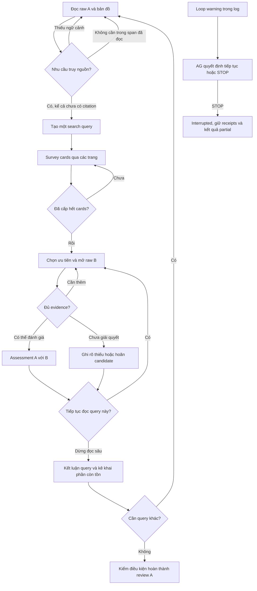

# Luồng model, context và tools trong bộ thử nghiệm

## Luồng CM4 v27 — thay thế lịch xử lý CM4 cũ ở dưới

Áp dụng live gate-enabled, engine `cm4-query-review-v27`, ngày 19/11/2026. Hướng dẫn chạy thật: [AG_CHECK](../../reviews/cm4_query_review_v24/AG_CHECK.md).

| Bước | Tools có thể được cấp | Điều kiện / tác dụng |
|---|---|---|
| Đọc A | `expand_query_map`, `read_query_passages`, continuation/context được cấp | Map preview chưa là raw; giữ source refs/hash/byte spans |
| Ghép vùng A đã đọc | `read_query_span` | Chọn host-issued span_ref liên tục qua các cửa sổ đã giao, không vượt payload budget; không tự đặt offsets hoặc lấp vùng chưa thấy |
| Xác định nhu cầu | `assess_source_need` | `search_needed` chọn mệnh đề; signal tùy chọn; partial được phép nếu đủ ngữ cảnh. `no_search_needed` không phủ phần chưa đọc |
| Tìm | `search_cases_by_issue` | Dùng permit và issue; chỉ issue gửi retrieval. Không được thực thi khi query trước còn mở |
| Survey | `show_context_page`, `prioritize_query_results`, đọc A/recovery phù hợp | Xem hết tập hits trước deep B. Priority chỉ là chọn đọc, không phải assessment |
| Đọc sâu | `open_retrieved_passage`, `read_case_passages`, `open_candidate_header`, các continuation/reload đang được cấp | Chỉ ứng viên đúng query/need. Có thể quay lại kết quả để đổi ưu tiên; không mở query khác |
| Đánh giá | `assess_case_link`, `record_missing_evidence`, `defer_case_pair`, `report_review_blocker` | Raw A/B hợp lệ; unknown và thiếu evidence được giữ rõ. Hoãn không tự đóng query |
| Kết luận search query | `conclude_search_query` | Chỉ sau survey đủ; host kê khai not_read/unresolved. Cho partial conclusion để tìm tiếp phần thiếu |
| Tìm lại cùng nhu cầu | `revisit_source_need` | Chỉ sau conclusion; query trùng trả kết luận cũ, query khác mở tập kết quả mới |
| Hoàn tất án A | `finish_case_review` | Chỉ khi case-level policy cho phép; khác với kết luận một search query |

V27: bước xác định/sửa/defer/resume/revisit nhu cầu chỉ được cấp khi không có query đang mở. Đọc thêm A vẫn được cấp theo nguồn, nhưng không tạo các permits mới chưa thể thực thi. Trong survey, xem `survey_position` và chọn `show_context_page` với `next_unseen`; previous vẫn cho quay lại có chủ đích, return results không tự reset về trang đầu. Assignment priority không đổi không được cấp; một tool descriptor dùng eligibility theo giá trị priority. Xem [kiểm v27](../../reviews/cm4_survey_focus_fix_v1/REPORT.md).

Tool lặp lại qua nhiều bước nếu đủ điều kiện; bảng không phải lịch cứng gọi một lần/tool. Schema/refs của đúng request là nguồn quyết định cuối. `prioritize_query_results` xử lý một nhóm refs hiển thị với lý do chung để output vẫn trong cap 512.

Payload giữ counters retrieved, survey_exposed/not_exposed, selected_for_read, raw_exposed, assessed, assessed_by_relation, not_read và unresolved. Unknown được đếm assessed về protocol nhưng vẫn unresolved về quan hệ nguồn. Báo cáo tách unique cases khỏi query–candidate pairs. Delivery là cơ hội thấy nội dung, không chứng minh hiểu/ngữ nghĩa đúng. Preview compile hoặc admission chưa có response không làm survey complete.

Loop guard mặc định warn, AG điều khiển STOP. Warn không vô hiệu hóa schema/provenance validation; unknown provider/admission không được tự resend. Run dừng khi còn việc phải báo interrupted/partial, không gọi là query đã kết luận. Xem report local để biết giới hạn đã kiểm; chưa nghiệm thu live/semantic.

Lịch sử tham khảo: [MODEL_CONTEXT_FLOW_HISTORY.md](MODEL_CONTEXT_FLOW_HISTORY.md). Không dùng lệnh run lịch sử cho code hiện hành.
