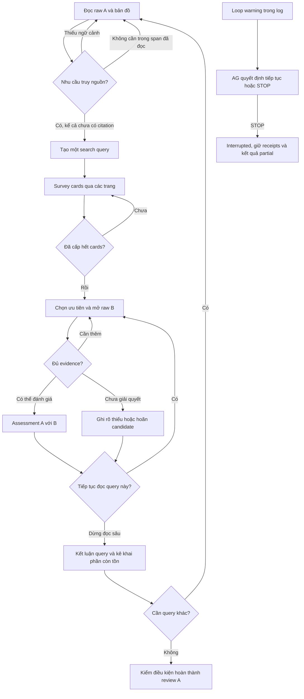
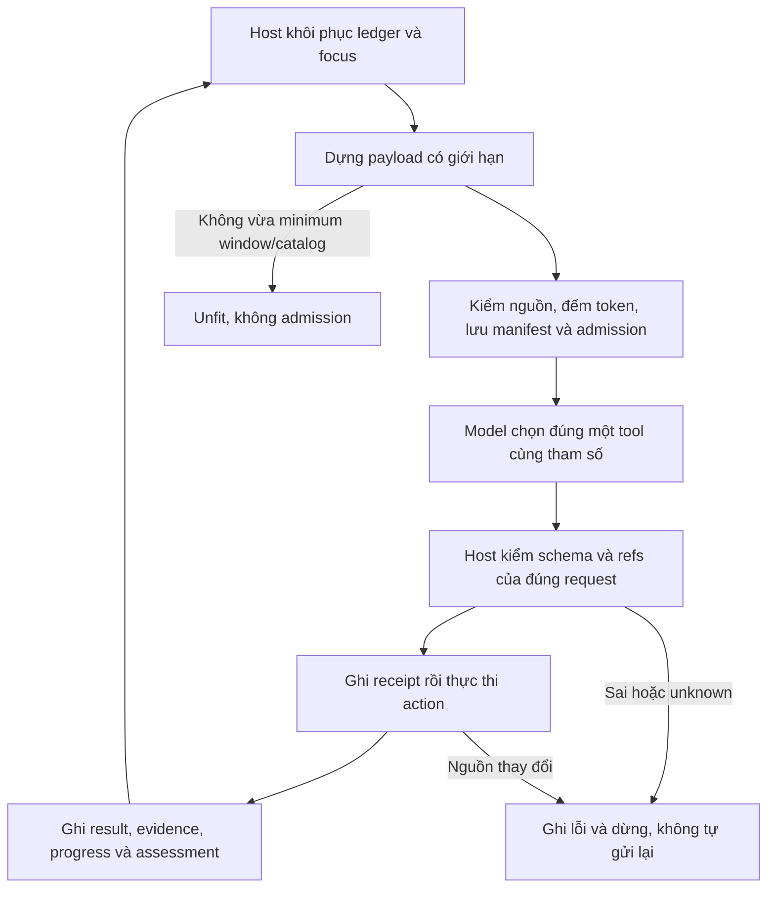
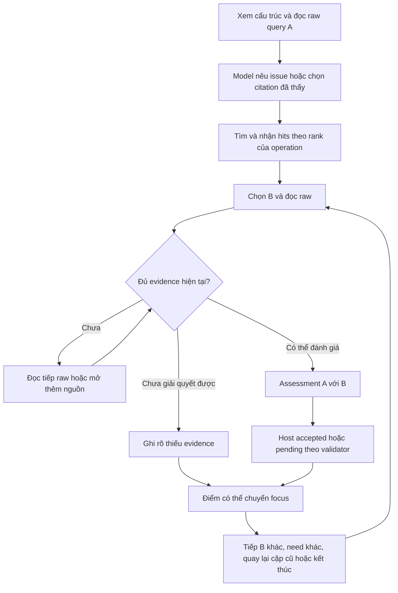

# Luồng model/context — lưu trữ trước cleanup v25

Không dùng bảng tool/lịch điều hướng trong file này cho CM4 hiện hành. Xem [MODEL_CONTEXT_FLOW.md](MODEL_CONTEXT_FLOW.md).

## Luồng CM4 v24 — thay thế lịch xử lý CM4 cũ ở dưới

Áp dụng live gate-enabled, engine `cm4-query-review-v24`, ngày 19/11/2026. CM2/CM3 offline legacy có thể giữ lịch khác để replay. Hướng dẫn chạy thật: [AG_CHECK](../../reviews/cm4_query_review_v24/AG_CHECK.md).

| Bước | Tools có thể được cấp | Điều kiện / tác dụng |
|---|---|---|
| Đọc A | `expand_query_map`, `read_query_passages`, continuation/context được cấp | Map preview chưa là raw; giữ source refs/hash/byte spans |
| Ghép vùng A đã đọc | `read_query_span` | Chọn host-issued span_ref liên tục qua các cửa sổ đã giao, không vượt payload budget; không tự đặt offsets hoặc lấp vùng chưa thấy |
| Xác định nhu cầu | `assess_source_need` | `search_needed` chọn mệnh đề; signal tùy chọn; partial được phép nếu đủ ngữ cảnh. `no_search_needed` không phủ phần chưa đọc |
| Tìm | `search_cases_by_issue` | Dùng permit và issue; chỉ issue gửi retrieval. Không được thực thi khi query trước còn mở |
| Survey | `show_context_page`, `prioritize_query_results`, đọc A/recovery phù hợp | Xem hết tập hits trước deep B. Priority chỉ là chọn đọc, không phải assessment |
| Đọc sâu | `open_retrieved_passage`, `read_case_passages`, `open_candidate_header`, các continuation/reload đang được cấp | Chỉ ứng viên đúng query/need. Có thể quay lại kết quả để đổi ưu tiên; không mở query khác |
| Đánh giá | `assess_case_link`, `record_missing_evidence`, `defer_case_pair`, `report_review_blocker` | Raw A/B hợp lệ; unknown và thiếu evidence được giữ rõ. Hoãn không tự đóng query |
| Kết luận search query | `conclude_search_query` | Chỉ sau survey đủ; host kê khai not_read/unresolved. Cho partial conclusion để tìm tiếp phần thiếu |
| Tìm lại cùng nhu cầu | `revisit_source_need` | Chỉ sau conclusion; query trùng trả kết luận cũ, query khác mở tập kết quả mới |
| Hoàn tất án A | `finish_case_review` | Chỉ khi case-level policy cho phép; khác với kết luận một search query |

Tool lặp lại qua nhiều bước nếu đủ điều kiện; bảng không phải lịch cứng gọi một lần/tool. Schema/refs của đúng request là nguồn quyết định cuối. `prioritize_query_results` xử lý một nhóm refs hiển thị với lý do chung để output vẫn trong cap 512.

Payload giữ counters retrieved, survey_exposed/not_exposed, selected_for_read, raw_exposed, assessed, assessed_by_relation, not_read và unresolved. Unknown được đếm assessed về protocol nhưng vẫn unresolved về quan hệ nguồn. Báo cáo tách unique cases khỏi query–candidate pairs. Delivery là cơ hội thấy nội dung, không chứng minh hiểu/ngữ nghĩa đúng. Preview compile hoặc admission chưa có response không làm survey complete.

Loop guard mặc định warn, AG điều khiển STOP. Warn không vô hiệu hóa schema/provenance validation; unknown provider/admission không được tự resend. Run dừng khi còn việc phải báo interrupted/partial, không gọi là query đã kết luận. Xem report local để biết giới hạn đã kiểm; chưa nghiệm thu live/semantic.

## Tài liệu nền và luồng legacy trước v24

Các phần dưới giữ chi tiết kho evidence, park/resume và lịch cũ; khi mô tả search/finish hoặc loop guard khác bảng trên thì dùng contract v24. Bảng tool legacy không phải API source gate hiện tại.

Phạm vi: `context_manager_v2`. CM2–CM3 vẫn có replay offline; vòng inference CM4
đã nối qua `live.py` theo `CM4.md`. Code được kiểm với provider giả lập và local
preflight; chưa chạy Modal thật. Sơ đồ mô tả contract của cả hai chế độ.

## 1. Vòng quyết định

Mỗi lượt model thấy: hướng dẫn; query ID/hash; focus need–candidate và stage;
một trang cards/needs/parked phù hợp mode; raw A/B đang mở; coverage còn thiếu;
và catalog tools có tham số hợp lệ. Model trả `{action, args}`. Không tự đặt
byte offsets, case ID tùy ý, channel, K hoặc fusion; host cấp refs và cố định
tham số retrieval. Mã lựa chọn có thể đổi theo revision, tên tool giữ theo chức năng.

Prompt được đếm bằng tokenizer pin, tối đa 8.500 input/512 output; mục tiêu mềm
7.900. Trang tối đa 5 cards, có thể ít hơn để giữ raw hữu ích. Nếu vẫn quá dài,
host chia raw theo biên UTF-8; không tự tóm tắt nội dung pháp lý.

## 2. Luồng làm việc trên một need

Sau search có hits, stage `results_ready` chỉ mở đọc B, xem trang, ghi thiếu
evidence hoặc kết thúc; search tạo need mới mở lại sau boundary hợp lệ. Trong
`reading`, host chặn search tạo need mới và đọc B khác. Có thể tiếp tục
đọc cặp hiện tại, assessment, hoặc ghi rõ thiếu gì trước khi chuyển. Đổi trang
không tự đổi focus. `no_hit`/error cũng tạo điểm cân nhắc hướng khác. Host không
ép lịch round-robin; model chọn hướng từ những lựa chọn hợp lệ.

Assessment chỉ dùng refs raw A/B trong payload của lượt đó; preview tìm kiếm
và raw từng đọc nhưng đã park không đủ điều kiện. Validator có thể accepted
nhãn `unknown` về giao thức hoặc giữ pending attribution; cả hai đều không phải
gold. Host selector chịu trách nhiệm prediction cuối; chưa có selector thì giữ
`pending_selection`, model không tự chọn cutoff.

## 3. Thông tin được lưu ở đâu

| Lớp | Nội dung | Nơi lưu / model có thấy? |
|---|---|---|
| Nguồn canonical | Toàn văn án, source hash; passage/paragraph provenance, offsets | Corpus local và reader hiện hành; không nạp toàn bộ vào prompt |
| Ledger của run | Config/bindings, requests, exact payloads, receipts, actions/results, raw records đã fetch, candidate pool, assessments | `session/events.sqlite3`; host replay để dựng `RunState` |
| Context state | Focus, stage, mode, page/back, pins và tiến độ từng need–candidate/root, lý do thiếu của đúng cặp | `cm_context` trong event result; không chỉ giữ trong RAM |
| Manifest mỗi request | Context/revision, schema, refs→targets, raw coverage, payload/schema/code/tokenizer hashes | `session/manifests/<request_id>.json`; dùng kiểm response đúng lượt |
| Model view | Trang hiện tại, một raw window A và một raw window B, coverage và tools hiện hành | Payload được dựng lại mỗi lượt; không phải toàn bộ lịch sử chat |
| Báo cáo | Số lượt giả lập, token admission, hashes, kết quả replay/stress | `report.json`; không thay thế ledger hay provider receipt |

`EvidenceStore` là lớp kiểm hash/raw và chia cửa sổ, không phải một kho vector
mới. Raw records fetch được lưu trong ledger/catalog; văn bản gốc vẫn ở corpus.
Park bỏ raw khỏi view, giữ record và assessment trong kho. Các need được giữ
theo ID từng operation; không tự gộp hai issue vì thấy tương tự.

Phân biệt ba mốc:

1. **Fetched:** reader đã lấy raw về, có source record/provenance trong ledger.
2. **Offered:** raw được đóng trong payload đã admission; chưa chắc model đã nhận.
3. **Delivered:** có receipt nhận phản hồi; action commit lưu tiến độ dùng để
   điều hướng lượt sau. Crash/unknown không được tự tính là đã đọc hay gửi lại.

## 4. Đọc dở, park, resume và reload

Progress phải gắn với **(need, candidate, canonical root)**. Hai cặp dùng chung
đoạn A vẫn có tiến độ riêng. Offset của cửa sổ hiện tại phục vụ assessment;
offset kế tiếp thể hiện phần đã giao thành công để tiếp tục không đọc lặp.

Ví dụ: root B1 dài 3.600 byte, đã nhận [0,2048], rồi chuyển sang B2. Quay lại B1
qua continuation sẽ dùng offset 2048. Park cặp rồi resume tiếp tục phần chưa đọc
của cặp đó; không lấy offset của cặp khác. `reload_pair_evidence` là yêu cầu
đọc lại từ đầu có chủ đích, reset riêng tiến độ cặp hiện tại và vẫn tốn token.

`missing_reason` thuộc cặp đã ghi nó. Khi chọn cặp mới, không mang reason cũ
sang; khi quay lại, trạng thái phải phản ánh cặp được chọn. Lịch sử lý do vẫn
nằm trong ledger, không bị xóa khỏi evidence audit.

Registry model chỉ đưa `need_id`, `candidate_id`, `stage`, `mode` từ `cm_context`.
Bản `cm4-feedback-v3` thêm `last_action_feedback` riêng: outcome vừa thực thi,
search thành công gần nhất, next tools và missing reason đúng current pair khi
stage phù hợp. Không đưa toàn bộ host history hoặc reason cặp khác vào model.
`cm_page.candidates` là danh sách có thứ tự để JSON hash-map không đổi thứ tự
trình bày native rank; map refs vẫn dùng cho dispatch.

## 5. Tools model có thể được cấp

Không cấp toàn bộ tools mọi lượt. Host dựng `available_tools` và schema theo
raw/focus/mode/revision; refs chỉ hợp lệ cho đúng manifest đã phát hành.

| Tool | Model chọn gì? | Kết quả / điều kiện chính |
|---|---|---|
| `expand_query_map` | `map_ref` | Xem cấu trúc A; chỉ trong query mode và có map options; preview chưa là raw |
| `read_query_passages` | `query_ref` | Đọc raw vùng A theo navigation đã cấp |
| `search_cases_by_issue` | Issue, `a_paragraph_ref`, source proposition | Tìm từ raw A hiện tại, có thể partial; host cố định channel/limit; chặn khi đang reading |
| `find_citation_matches` | `citation_ref` | Tìm citation đúng chuỗi đã quan sát trong A; chưa chứng minh identity; chặn khi reading |
| `continue_citation_search` | `search_ref` | Tiếp trang tìm citation còn coverage; chặn khi reading |
| `read_case_passages` | `candidate_ref`, focus pháp lý | Mở lead hoặc tìm trong B rồi đọc; chỉ ứng viên thuộc need hiện tại, không đổi B giữa reading |
| `read_more_context` | `context_ref` | Reader mở thêm vùng/neighbor/source continuation đã cấp; có thể fetch raw mới |
| `continue_raw_evidence` | `context_ref` | Đưa cửa sổ tiếp của raw đã fetch vào view, hoặc chuyển root còn chờ; không tự gọi retrieval |
| `assess_case_link` | `pair_ref`, relation/location/reason; refs attribution nếu có | Đánh giá bằng raw A/B current; qua validator M4; thiếu evidence có thể pending |
| `review_conflicting_link` | Pair và finding theo trigger | Chỉ có khi host phát hiện trigger và profile cho phép review; profile replay hiện tại `max_reviews=0` |
| `show_context_page` | `page_ref` | Xem query/results/pool/needs/parked/assessment, next/previous; không đổi focus hay tăng raw coverage |
| `set_context_focus` | `need_ref` trên trang needs | Chọn need khác tại safe boundary; không gọi search ngầm |
| `record_missing_evidence` | Lý do thiếu cụ thể | Ghi thiếu cho cặp reading hoặc need đang results_ready, cho phép cân nhắc chuyển hướng |
| `resume_pair_evidence` | `evidence_ref` trên parked page | Quay lại đúng need/B và tiến độ của cặp, không search/source-read lại |
| `reload_pair_evidence` | `evidence_ref` cặp hiện tại | Nạp lại raw từ đầu có chủ đích; kiểm source hash; không xóa assessment vì park/reload |
| `finish_case_review` | Lý do kết thúc được cấp | Dừng; host chọn prediction hoặc để pending_selection |

`reload_evidence` của policy gốc không được cấp trong adapter này: registry
reloads gốc để rỗng, thay bằng hai thao tác pair-specific ở trên. Các tên nội bộ
như `open_source`, `search_corpus`, `assess_links` là dispatch host sau dịch tool,
không phải lựa chọn trực tiếp mà model tùy ý gọi.

## 6. Giới hạn hiện tại

Một window mỗi phía chưa bảo đảm chứa đủ các đoạn attribution/quote-chain rời
nhau; trường hợp thiếu vẫn pending/unknown. Thứ tự card có thể ảnh hưởng hành vi:
results giữ rank operation; pool giữ first-seen cho audit, chưa chứng minh trung
lập. Offline PASS không chứng minh model tự chọn đúng hoặc chất lượng COLIEE.

AG có quyền dừng bằng STOP tại safe boundary. CM4 có LoopGuard cảnh báo/dừng
theo chu kỳ context hoặc thiếu tiến triển thực, khôi phục counters từ ledger;
đây là heuristic, không bảo đảm bắt mọi vòng lặp ngữ nghĩa. Unknown/crash,
malformed và source drift có đường chặn/dừng kỹ thuật. STOP không ngắt tức thì
remote đang chờ; user/AG cần xử lý call đang treo theo call ID. Không diễn giải
các lượt giả lập thành live run hoặc chứng nhận semantic correctness.
